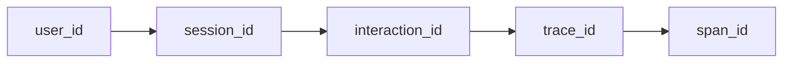
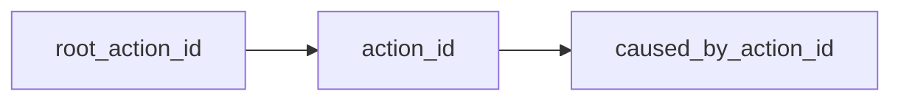

The Agent Action Graph is Observability Unified's causal view of human and agent work.
Traditional traces show execution order. The action graph adds the semantic
"why": which browser action, cron job, agent run, LLM call, retrieval, or tool
call caused the next step.

Use it when you need to answer:

- Which user action or background job started this agent run?
- Which model step chose a side-effecting tool?
- Which retrieval or prompt version influenced the answer?
- Which backend trace, log line, replay, AI cost, CPU profile, or eval case is
  connected to this action?

## Identity model

The graph extends the normal interaction chain:



with action-level causality:



Browser-triggered agents create a fresh `root_action_id` while retaining the
browser `interaction_id`. Background agents, cron jobs, and MCP hosts can also
mint action roots when there is no browser interaction.

## What becomes graph data

Observability Unified projects these records into the action graph when explicit action
fields are present or derivable:

- Native SDK agent runs and steps
- LLM calls, retrievals, tool calls, guardrails, and eval cases
- OpenInference-shaped spans
- OpenTelemetry GenAI spans
- OpenTelemetry MCP spans such as `tools/call`, `resources/read`, and
  `prompts/get`
- Backend traces, logs, profiles, and replay evidence sharing the same identity
  chain

## Dashboard surface

In the dashboard, action graph pages are nested, bookmarkable routes:

```text
#/actions/:actionId
#/agent-runs/:agentRunId
#/tool-calls/:toolCallId
```

Each page shows action metadata, upstream/downstream causes, connected telemetry,
and graph tabs for the causal action tree, governance/auditing, and prompt
diffs/evals.

The website screenshot pipeline now captures the route directly from the seeded
Astronomy demo. The current public captures are:

- [Agent Action Graph](https://obsunified.com/screenshots/app/agent-action-graph.png)
- [Interaction ID path](https://obsunified.com/screenshots/app/interaction-id-path.png)
- [Trace waterfall with Connected Rail](https://obsunified.com/screenshots/app/trace-waterfall-connected-rail.png)
- [Trace to CPU profile join point](https://obsunified.com/screenshots/app/trace-profile-slot.png)

## Agent surface

The same graph is exposed to AI agents through the [MCP server](/docs/mcp-server).
An agent can start from a failing trace, follow connected signals to an action,
inspect the action graph, then return with the relevant replay, log, AI cost, or
profile evidence.

For implementation details in the GitHub repo, see the
[Agent Action Graph guide](https://github.com/dev-sawan-ruparel/obs-unified/blob/main/docs/agent-action-graph.md)
and the
[Action ID wire spec](https://github.com/dev-sawan-ruparel/obs-unified/blob/main/docs/spec/action-id.md).

## Side-effect evidence

A tool call flagged `sideEffect: true` tells you where risk is. Side-effect
evidence tells you what actually changed. Your app attaches it to the tool-call
span as attributes; the collector does not compute diffs or fetch state itself.

| Attribute | Stored as |
| --- | --- |
| `obs.tool_call.mutation.before` | `mutationBeforeJson` |
| `obs.tool_call.mutation.after` | `mutationAfterJson` |
| `obs.tool_call.mutation.diff` | `mutationDiffJson` |
| `obs.tool_call.mutation.artifact_id` | `mutationArtifactId` (a string id or link you control) |

The `obs.tool.mutation.*` and `tool.mutation.*` spellings are accepted as
aliases. The span must be recorded as a tool call, for example one created
with `tool()` or one carrying `obs.tool.name` or `obs.tool_call.tool_name`.

With the TypeScript SDK, set them from inside `tool()`. Serialize objects with
`JSON.stringify`: the SDK exports non-primitive attribute values with
`String(value)`, so a raw object arrives as `[object Object]`.

```ts
import { tool } from "@obsunified/telemetry-sdk";

declare function loadInvoice(id: string): Promise<{ status: string }>;
declare function markPaid(id: string): Promise<{ status: string }>;

const invoiceId = "inv_123";

await tool(
  {
    name: "mark_invoice_paid",
    arguments: { invoiceId },
    sideEffect: true,
    approvalState: "human_approved",
  },
  async (toolCall) => {
    const before = await loadInvoice(invoiceId);
    const after = await markPaid(invoiceId);
    toolCall.setAttribute(
      "obs.tool_call.mutation.before",
      JSON.stringify({ status: before.status }),
    );
    toolCall.setAttribute(
      "obs.tool_call.mutation.after",
      JSON.stringify({ status: after.status }),
    );
    toolCall.setAttribute(
      "obs.tool_call.mutation.diff",
      JSON.stringify([{ op: "replace", path: "/status" }]),
    );
    toolCall.setResult({ ok: true });
  },
);
```

Where it shows up:

- **Tool call page** (`#/tool-calls/:toolCallId`): a "Mutation Evidence" card
  with `before`, `after`, `diff`, and `artifact_id`. The action tree marks nodes
  that have any tool evidence with an `evidence` badge.
- **Autonomous Review**: side-effecting tool calls from runs with
  `autonomyLevel: "autonomous_write"` get an Evidence column (`diff` or `none`)
  and a "With Mutation Evidence" count. The list API is
  `GET /internal/actions/aggregates/autonomous-review`, which returns
  `mutationEvidence` (boolean) and `mutationArtifactId` per row.
- **APIs and MCP**: `GET /internal/tool-calls/:id`, the MCP `get_tool_call`
  tool, and a `tool_call` evidence ref expanded with `retrieve_evidence_ref`
  all return the four `mutation*` fields.
- **Eval cases**: saving an eval case whose source links to an action or tool
  call copies the
  evidence into `metadata.toolHashes[].mutationEvidence` (`before`, `after`,
  `diff`, `artifactId`), so it travels with the case.

Limits:

- Only what your app sends is shown. Nothing is captured automatically.
- The collector stores these values as sent. It does not run payload redaction
  on them, and the project's payload-capture setting does not gate them. Send
  summaries (status fields, counts, ids, hashes) or an `artifact_id`, not full
  records or secrets.
- The values are removed from the stored span and action attributes and kept
  only in the tool-call record.

## MCP call audit

When an MCP server handles a `tools/call`, `resources/read`, or `prompts/get`
request, the request's `params._meta` shows what trace and action context
crossed the boundary. It can also hold vendor data, tokens, or other private
metadata, so Observability Unified does not store raw `_meta`. Instead, build an
allow-listed audit envelope with `buildMcpAuditEnvelope` and attach it to the
span as `obs.mcp.audit`.

`buildMcpAuditEnvelope(params, options?)` returns an `McpAuditEnvelope` (or
`undefined` when there is no `_meta` object):

- `allowedFields`: only `traceparent`, `obs.action.root_id`, `obs.action.id`,
  `obs.root_action_id` / `obs.action_id` (from the nested `obs` object), and
  `baggage.obs.interaction.id`, with their values.
- `presentFields`: every top-level `_meta` key name.
- `hashedFields`: SHA-256 hashes of every other field's value, plus
  `tracestate` and `baggage`.
- `droppedFields` and `redactedFields`: which keys were dropped or reduced.
- `hasRawMeta`: `false` unless you pass `{ captureRawMeta: true }`. That option
  adds `rawMetaRedacted`, a copy with keys such as `authorization`, `cookie`,
  `token`, `secret`, `password`, `api-key`, and `email` replaced by
  `[REDACTED]`. The collector does not persist `rawMetaRedacted` either; it
  keeps only the flag.

```ts
import { buildMcpAuditEnvelope, tool } from "@obsunified/telemetry-sdk";

declare const params: {
  name: string;
  arguments?: Record<string, unknown>;
  _meta?: Record<string, unknown>;
};
declare function runTool(name: string, args: unknown): Promise<unknown>;

const envelope = await buildMcpAuditEnvelope(params);

await tool({ name: params.name, arguments: params.arguments ?? {} }, async (toolCall) => {
  if (envelope) toolCall.setAttribute("obs.mcp.audit", JSON.stringify(envelope));
  const result = await runTool(params.name, params.arguments);
  toolCall.setResult(result);
  return result;
});
```

`obs.mcp.audit_json`, `mcp.audit`, and `mcp.audit_json` are accepted as
aliases. The collector only accepts an object with a `presentFields` array and
an `allowedFields` object; anything else, including a raw `_meta` object, is
ignored and no audit is stored. Accepted envelopes are normalized to
`schemaVersion`, `presentFields`, `allowedFields`, `redactedFields`,
`hashedFields`, `droppedFields`, and `hasRawMeta`.

Where it shows up:

- On any action-graph span (for example a `resources/read` span), the
  normalized envelope is kept in the action attributes as `obs.mcp.audit_envelope`, and the
  original `obs.mcp.audit` attribute is removed.
- On tool-call spans it is also stored as `mcpAuditJson`. The tool call page
  shows it in an "MCP Transport Audit" card, the action tree shows the
  `evidence` badge, and `GET /internal/tool-calls/:id`, `get_tool_call`, and
  `retrieve_evidence_ref` return it.
- Eval cases saved from the action or tool call copy it into
  `metadata.toolHashes[].mcpAudit`.

The SDK does not attach the envelope for you: `extractMcpContext` restores
trace and action context but does not set `obs.mcp.audit`. The helper is in
the TypeScript SDK (`@obsunified/telemetry-sdk` and
`@obsunified/telemetry-sdk/mcp`).

## Production traces to eval cases

A production failure can be saved as an eval case, re-run against a candidate
agent, prompt, or model, and compared step by step with the original.

**Save a case.** Use **Save as eval case** on a trace, AI span, action, agent
run, or tool call page, or call `POST /internal/eval-cases`:

```json
{
  "sourceEntityType": "agent_run",
  "sourceEntityId": "01J3Y4Z5A6B7C8D9E0F1G2H3J4",
  "name": "Refund agent paid the wrong invoice",
  "expectedOutcome": "Asks for confirmation before paying",
  "rubric": { "mustAskConfirmation": true }
}
```

`sourceEntityType` is one of `trace`, `agent_run`, `action`, `tool_call`, or
`ai_call`. The collector checks that the source exists (404 if not) and fills
in the linked agent run, action, tool call, trace, and span ids. If you don't
send `redactedPrompt` or `referencePayload`, it copies the stored AI payload
input and output for the source, when there is one. It also adds `metadata`:
`linkedSpans`, `toolHashes` (tool name, argument and result hashes, plus any
MCP audit and side-effect evidence), `documentRefs` from retrievals, and
`sourceLinks`. Read cases with `GET /internal/eval-cases` (filter by
`sourceEntityType` and `sourceEntityId`) and `GET /internal/eval-cases/:id`.

**Record a candidate run.** `POST /internal/eval-runs` creates a durable run
record, separate from per-case results:

- `evalCaseId` (optional, must exist), `status` (`pending`, `running`,
  `completed`, `failed`, `canceled`; default `running`), and an optional `id`.
- `candidate`: `agentId`, `agentVersion`, `promptId`, `promptVersion`,
  `modelProvider`, `model`, `modelVersion`, plus `environment`,
  `serviceVersion`, `commitSha`, and `configDigest` (also accepted at the top
  level).
- `inputPayloadHash`, `failureFingerprint`, `startedAt`, `endedAt`, and
  `metadata`.

**Report results.** `POST /internal/eval-cases/:id/results` takes `runId`,
`passed` (required boolean), `score`, `actualOutcome`, `inputPayloadHash`,
`failureFingerprint`, and `details`. When `runId` names an existing run, the
run's `totalCount`, `passCount`, `failCount`, and `averageScore` are
recomputed. A result with a `runId` that has no run record is still stored, but
has no candidate dimensions. Results returned by
`GET /internal/eval-cases/:id/results` carry `evidenceReferences` back to the
production source; runs from `GET /internal/eval-runs` and
`GET /internal/eval-runs/:id` include `candidate` and a `sourceEvalCase` with
its source ids and evidence references.

**Compare.** The Evaluations page shows a "Production source" panel with an
**Open source** link, an "Evaluation candidate" panel (run id, candidate
agent/prompt/model version, score, pass/fail), and a production-vs-eval table
for step count, tool count, cost, and outcome. Below it, an "Action tree diff"
lists each step as `same`, `changed`, `added`, or `removed`, with the changed
fields and links to each step's action or tool call page. The diff uses
`GET /internal/actions/compare?left=<id>&right=<id>`, which accepts action or
agent run ids.

For the diff to work, the candidate execution must be instrumented as its own
agent run, and you must say which one: put its id in the result `details` as
`candidate.agentRunId`, `candidateAgentRunId`, or `agentRunId` (action ids work
too), or in the run's `metadata` as `candidateAgentRunId`. Otherwise the page
tries the `runId`, and shows "Comparable production and eval action graph IDs
were not found" if that is not an action graph id.

Limits: there is no SDK or CLI helper for eval runs or results. Use the HTTP
routes above. There is no MCP tool that reads eval cases or runs.
`record_investigation_finding` can cite eval runs in its `counterfactual`
field (see [AutoSRE](/docs/autosre)). The MCP `get_eval` tool reads AI
evaluation records, not eval cases.
