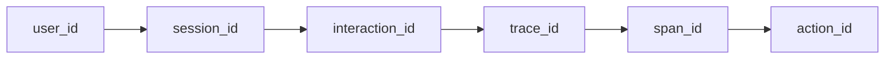
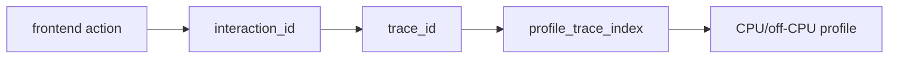

Observability Unified gives AI agents the context they need to debug production software. It connects telemetry such as traces, logs, replays, profiles, and agent actions into one evidence graph. Agents can retrieve relevant evidence through MCP, and engineers can inspect the same records in the dashboard.

Self-host with Cloudflare Workers, D1, and R2 or use the Node collector with Postgres and S3-compatible blob storage.

## What's in this documentation

- [Getting started](/docs/getting-started) — choose Docker or local dev, then choose seeded data, Astronomy Shop, or your own app.
- [Installation](/docs/installation) — the prebuilt GHCR image, the seeded local image, the editable local repo, and where every package is published (npm, GHCR, crates.io, Go modules).
- [Examples](/docs/examples) — runnable demos, scaffold templates, SDK examples, recipes, and migration guides.
- [SDKs](/docs/sdks) — `@obsunified/analytics-sdk` (browser, click + interaction propagation), `@obsunified/telemetry-sdk` (Node/Workers), plus Go and Rust.
- [SDK API reference](/docs/sdk-reference) — compact method map for init, interaction stamping, LLM/tool spans, MCP context propagation, and Cloudflare wrappers.
- [Evidence reference](/docs/evidence-reference) — machine-readable evidence references with entity IDs, routes, confidence, citations, and pivots.
- [Evidence retrieval (CCR)](/docs/evidence-retrieval) — compact, token-budgeted evidence bundles and retrieval refs that let agents pull just the debugging signal, not the raw firehose.
- [Agent Action Graph](/docs/agent-action-graph) — debug agent runs as causal workflows across LLM calls, retrievals, tool calls, traces, logs, profiles, and eval cases.
- [AutoSRE causal ontology](/docs/autosre) — change correlation, traffic-normalized cohort lift, noisy-neighbor contention checks, counterfactual verification, and guarded autonomous remediation.
- [MCP server](/docs/mcp-server) — give AI agents investigation tools that are read-only by default. The collector uses a separate read/admin bearer token.
- [Instrumenting](/docs/instrumenting) — concrete React + Worker examples that produce signals correlated end-to-end.
- [Python Flask instrumentation](/docs/instrument-python-flask) — OpenTelemetry setup for a Flask service.
- [What to expect](/docs/what-to-expect) — the click-to-CPU scenarios the platform was built around, with the rail's role at every hop.
- [Production operations](/docs/ops/production) — reverse proxy, Postgres tuning, storage retention, and Kubernetes notes.
- [Product evaluation](/docs/comparison) — architecture and product evaluation guide, self-hosted deployment models, and comparison audit status.

## The unified-stack promise

That identity skeleton is the unifying layer. The SDKs propagate it, the collector stores it, and the dashboard plus MCP server use it to connect product behavior, backend execution, agent actions, AI cost, logs, replay, alerts, profiles, and analyses. Read the [SDKs](/docs/sdks) page for which ID is minted where, [Agent Action Graph](/docs/agent-action-graph) for agent causality, and [What to expect](/docs/what-to-expect) for the journeys it makes possible.

The click-to-CPU path is deliberately precise: the browser mints `interaction_id`, the backend stamps it onto spans/logs/AI calls/MCP tool context, and profiles join through the `trace_id` those spans belong to. In shorthand:

<Callout type="info">
This documentation describes the platform as it ships on `main` today. For the fastest first run, pull the prebuilt image `ghcr.io/dev-sawan-ruparel/obs-unified` as shown in [Installation](/docs/installation), or follow [Getting started](/docs/getting-started) to choose a runtime and data path.
</Callout>
