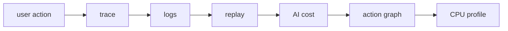

`@obsunified/mcp-server` is a stdio Model Context Protocol server for agents
that need to inspect an obs-unified collector.

It exposes the same investigation graph that humans use in the dashboard:
status, recent traces, trace detail, service operations, service map, logs, AI
sessions, users, replays, profiles, evals, compact evidence bundles, connected
signals, agent runs, actions, and tool calls.

## Why it exists

Modern debugging is increasingly agent-assisted. Instead of asking an agent to
guess from screenshots or copy-pasted log snippets, obs-unified gives it
structured tools over the telemetry graph:



The MCP server is a **read boundary by default**. It lets agents traverse evidence without
granting write access to telemetry ingest.

## Install

The MCP server is published to the public npm registry as
[`@obsunified/mcp-server`](https://www.npmjs.com/package/@obsunified/mcp-server):

```bash
pnpm add -g @obsunified/mcp-server
```

Or run it without installing, which is what most MCP host configs do:

```bash
pnpm dlx @obsunified/mcp-server
```

> [!NOTE]
> The MCP server uses the `@obsunified` scope on public npm (`@obsunified/mcp-server`). The first-party SDKs use the `@obsunified` scope on public npm (`@obsunified/*`).

For local development from a checkout:

```bash
git clone https://github.com/dev-sawan-ruparel/obs-unified.git
cd obs-unified
pnpm install
pnpm --filter @obsunified/mcp-server build
```

## Configure

Set the collector URL and one auth method:

```bash
export OBS_COLLECTOR_URL="https://obs.example.com"
export OBS_DASHBOARD_TOKEN="..."
```

Supported auth variables, in priority order:

- `OBS_DASHBOARD_TOKEN` — programmatic read/admin token, sent as `Authorization: Bearer <token>`. Must equal the collector server-side `DASHBOARD_TOKEN` (note: CLI clients use `OBS_ADMIN_TOKEN` for the same collector secret). `OBS_API_TOKEN` is accepted as an alias; if both are set, `OBS_DASHBOARD_TOKEN` wins.
- `OBS_SESSION_COOKIE` — dashboard `obs_session` cookie value for ad-hoc local
  use. A cookie-configured MCP host is indistinguishable from a human dashboard
  session on the collector's remediation approve/reject routes, so **do not use
  it for autonomous agents**; use a bearer token instead.

Ingest keys (`OBS_INGEST_KEY`) are write-only for telemetry ingestion (`/v1/*`) and are rejected on collector read/admin endpoints (`/internal/*`).

Optional variables:

- `OBS_PROJECT_ID` — sent as `X-Project-Id` for multi-project collectors.
- `OBS_DASHBOARD_URL` — used to include dashboard deep links in tool responses.
- `OBS_MCP_TIMEOUT_MS` — request timeout in milliseconds. Defaults to `30000`.
- `OBS_MCP_ENABLE_WRITES` — set to `true` to register the opt-in write tools (see below). Defaults to off.

## Claude Desktop, Cursor, or compatible MCP host

Zero-install config (runs directly from public npm):

```json
{
  "mcpServers": {
    "obs-unified": {
      "command": "npx",
      "args": ["-y", "@obsunified/mcp-server"],
      "env": {
        "OBS_COLLECTOR_URL": "https://obs.example.com",
        "OBS_DASHBOARD_TOKEN": "..."
      }
    }
  }
}
```

Or if installed globally with `pnpm add -g @obsunified/mcp-server`:

```json
{
  "mcpServers": {
    "obs-unified": {
      "command": "obs-unified-mcp",
      "env": {
        "OBS_COLLECTOR_URL": "https://obs.example.com",
        "OBS_DASHBOARD_TOKEN": "..."
      }
    }
  }
}
```

For local development from the monorepo (`pnpm run setup` and `docker/local/start.sh` default to `DASHBOARD_TOKEN=e2e-dashboard-token`):

```json
{
  "mcpServers": {
    "obs-unified": {
      "command": "pnpm",
      "args": [
        "--dir",
        "/absolute/path/to/obs-unified",
        "--filter",
        "@obsunified/mcp-server",
        "start"
      ],
      "env": {
        "OBS_COLLECTOR_URL": "http://localhost:8790",
        "OBS_DASHBOARD_TOKEN": "e2e-dashboard-token"
      }
    }
  }
}
```

Build the package first with:

```bash
pnpm --filter @obsunified/mcp-server build
```

## Example: `get_evidence_bundle`

Arguments for triaging an incident with a 2,000-token budget:

```json
{
  "anchor": { "entityKind": "incident", "entityId": "inc_scenario_d" },
  "intent": "triage_incident",
  "budget": { "targetTokens": 2000 }
}
```

`anchor` and its two fields are required. `intent` is optional, `budget.targetTokens` accepts 500 to 30000 (default 4000), `budget.detailLevel` is `brief`, `standard` (default), or `deep`, and `hours` (1 to 720, default 24) sets the lookback window.

Tool results use a `{ data, dashboardUrl }` envelope: `data` is the payload (here the evidence bundle) and `dashboardUrl` is a deep link into the dashboard, present only when the MCP server is configured with a dashboard URL. `obs_status` is the exception: it returns `{ ok, overview }`.

## Tools

- `obs_status`
- `get_evidence_bundle` — compact evidence for a `trace`, `action`, `agent_run`, `tool_call`, `change`, `finding`, or `incident` anchor, scoped to an investigation intent (`debug_failure`, `explain_latency`, `explain_cost`, `inspect_agent_run`, `inspect_tool_call`, `find_instrumentation_gap`, `triage_incident`, `general`) and token budget.
- `retrieve_evidence_ref` — expand a bundle retrieval ref into raw, less-compacted, or redacted records (`chunkOffset` paginates replay event windows).
- `search_evidence_ref` — search within a log retrieval ref without expanding the full evidence slice.
- `get_evidence_stats` — issued/expanded evidence-ref telemetry for the active project.
- `recent_traces`
- `get_trace`
- `service_operations`
- `service_map`
- `search_logs`
- `ai_overview`
- `get_ai_session`
- `get_user`
- `get_replay`
- `get_profile`
- `get_eval`
- `connected_signals`
- `get_agent_run`
- `get_action`
- `get_tool_call`
- `list_recent_changes` — list recent change events (`deploy`, `rollback`, `feature_flag`, `config_change`, `prompt_rollout`) filtered by environment, service, or target node.
- `get_change_blast_radius` — traffic-normalized cohort error lift, noisy-neighbor contention check, and code-path overlap for a change event.
- `search_similar_findings` — search historical `InvestigationFinding`s by fingerprint, symptom entity, or root-cause entity.
- `record_investigation_finding` — (write tool, requires `OBS_MCP_ENABLE_WRITES=true`) persist a structured `InvestigationFinding` with `relationshipCertainty`, `causalProofTier`, and optional counterfactual verification.
- `propose_remediation_action` — (write tool, requires `OBS_MCP_ENABLE_WRITES=true`) propose a governed remediation action (`rollback_deploy`, `toggle_feature_flag`, `open_code_pr`, `apply_config`, `promote_agent_prompt`) evaluated against the pre-execution policy gate.
- `claim_remediation_grant` — (write tool, requires `OBS_MCP_ENABLE_WRITES=true`) claim a single-use cryptographic `grantToken` (with target-version CAS) or complete/fail an active remediation execution.

## Write tools (opt-in)

The server is read-only by default. Three tools can change collector state, and
they are **not registered at all** unless you set `OBS_MCP_ENABLE_WRITES=true`:

- `record_investigation_finding` — persists an `InvestigationFinding` (and can chain counterfactual verification).
- `propose_remediation_action` — creates a policy-gated remediation proposal (rollback, flag toggle, config, prompt promotion, code PR).
- `claim_remediation_grant` — claims, completes, or fails a proposal using its single-use `grantToken`.

These calls require the dashboard bearer token (`OBS_DASHBOARD_TOKEN` or its alias `OBS_API_TOKEN`).
Enable them only for agents you intend to let record findings or drive remediation, and keep
the collector's remediation policy gate and human approval requirements in place.

For package-level details, see the
[MCP server README](https://github.com/dev-sawan-ruparel/obs-unified/blob/main/packages/mcp-server/README.md).

