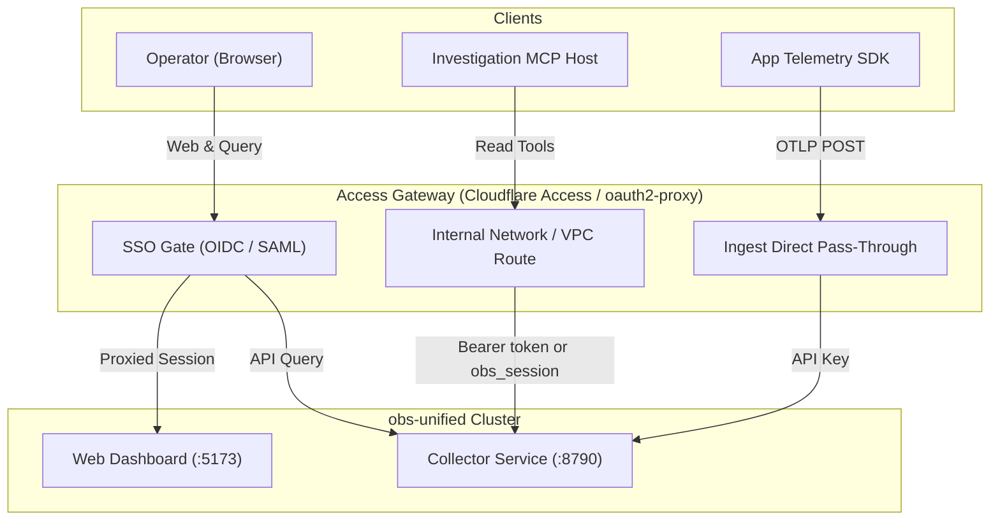

This guide covers production identity and perimeter access layer patterns for `obs-unified`. It provides concrete deployment recipes for Cloudflare Access and self-hosted `oauth2-proxy` with Nginx or Caddy. Adaptable configuration templates are provided in `examples/external-access/` for Nginx, Caddy, `oauth2-proxy`, and Cloudflare Tunnel (`cloudflared`). These are adaptable reference templates requiring site-specific domain, secret, and TLS certificate setup before deployment, rather than an all-in-one local Compose harness.

## Architectural realities & boundaries

Before configuring external access, understand how authentication operates in the `obs-unified` stack:

> [!IMPORTANT]
> **Native per-user RBAC and SSO are absent.**
> `obs-unified` does not contain native per-user Role-Based Access Control, user accounts, or SAML/OIDC handlers. The dashboard relies on a single shared `DASHBOARD_PASSWORD`. Any operator with dashboard access has full visibility into all telemetry projects and can create or revoke ingest keys. All per-user access control and identity federation must be enforced at an **external access layer**.

### Component access boundaries



1. **Dashboard authentication & programmatic token (`DASHBOARD_PASSWORD`, `DASHBOARD_TOKEN`)**:
   Managed in the collector via `dashboardAuth`. Browser login via `POST /auth/login` sets an HMAC-SHA256 signed `obs_session` cookie valid for 7 days. On `/internal/*`, the collector accepts either a valid `obs_session` cookie or a programmatic read/admin bearer token (`Authorization: Bearer <DASHBOARD_TOKEN>`). Programmatic client tokens map directly to this server secret:
   - **CLI client (`@obsunified/cli`)**: uses `OBS_ADMIN_TOKEN` for `keys mint` and `keys list`; this value must equal the collector server `DASHBOARD_TOKEN`.
   - **MCP server (`@obsunified/mcp-server`)**: uses `OBS_DASHBOARD_TOKEN` for telemetry inspection; this value must equal the collector server `DASHBOARD_TOKEN`.
   Ingest keys (`INGEST_KEY`, `OBS_INGEST_KEY`) are strictly write-only and cannot read `/internal/*`.
2. **Telemetry ingest API keys (`INGEST_KEY`, `ingest_keys` table)**:
   Managed via `ingestAuth`. Telemetry producers send `Authorization: Bearer <key>` or `X-API-Key: <key>` to `/v1/*` routes. Ingest keys grant **write-only** access and cannot read dashboard or internal query APIs.
3. **Public health endpoint (`/health`)**:
   Publicly accessible on the collector for load balancer health probes and client clock synchronization.
4. **Investigation MCP boundary (`@obsunified/mcp-server`)**:
   Read-only investigation server querying `/internal/*` routes.
   - Configure `OBS_DASHBOARD_TOKEN` on the MCP client matching `DASHBOARD_TOKEN` on the collector (or `OBS_SESSION_COOKIE` for ad-hoc browser session reuse). Note that while CLI clients configure `OBS_ADMIN_TOKEN`, MCP configures `OBS_DASHBOARD_TOKEN`; both authenticate against the collector server `DASHBOARD_TOKEN`.
   - The MCP client sends `Authorization: Bearer <OBS_DASHBOARD_TOKEN>` and optional `X-Project-Id`.
   - The MCP client does **not** emit Cloudflare Access service token headers (`CF-Access-Client-*`). Direct connection across a Cloudflare Access gate without a forwarding proxy is unsupported.
   - Run the MCP server within the trusted internal network or localhost boundary where it can directly reach the collector's port using `OBS_DASHBOARD_TOKEN`.
5. **`X-Project-Id` Handling**:
   The collector requires `X-Project-Id` for multi-project tenant scoping in the dashboard and MCP. The reverse proxy must pass `X-Project-Id` through.

---

## Route & policy topology

| Path | Backend | Access Layer Policy | Credential | Purpose |
| --- | --- | --- | --- | --- |
| `/health` | Collector `:8790` | Public / Bypass | None | Liveness & clock offset sync |
| `/v1/*` | Collector `:8790` | Bypass SSO | Ingest API Key | OTLP spans, logs, metrics, AI calls |
| `/auth/*` | Collector `:8790` | SSO Protected | `obs_session` | Dashboard session management |
| `/internal/*` | Collector `:8790` | SSO / Internal VPC | `obs_session` cookie or Bearer `DASHBOARD_TOKEN` | Telemetry & evidence queries |
| `/` | Dashboard `:5173` | SSO Protected | IdP Session Cookie | React SPA assets |

---

## Recipe 1: Cloudflare Access (Zero Trust)

Cloudflare Access protects origin infrastructure with edge-enforced identity policies for human operators.

### Hostname separation

The recommended configuration splits public ingest from authenticated dashboard traffic:
- `obs.example.com`: Protected by Cloudflare Access. Routes `/` to Dashboard `:5173`, `/internal/*` and `/auth/*` to Collector `:8790`.
- `ingest.example.com`: Bypasses Access. Routes `/v1/*` and `/health` directly to Collector `:8790`.

### Cloudflare Tunnel (`cloudflared`) configuration

Deploy `cloudflared` using the adaptable template in `examples/external-access/cloudflared-config.yml`. Tunnel UUID, credentials file setup, and ingress hostname configuration are required:

```yaml
tunnel: <TUNNEL_UUID>
credentials-file: /etc/cloudflared/<TUNNEL_UUID>.json

ingress:
  # Telemetry Ingest (Direct pass-through, authenticated via Ingest Key)
  - hostname: ingest.example.com
    path: ^/v1/
    service: http://127.0.0.1:8790
  - hostname: ingest.example.com
    path: ^/health$
    service: http://127.0.0.1:8790

  # Dashboard & Query Endpoints (Protected by Cloudflare Access)
  - hostname: obs.example.com
    path: ^/health$
    service: http://127.0.0.1:8790

  - hostname: obs.example.com
    path: ^/(auth|internal)/
    service: http://127.0.0.1:8790
  - hostname: obs.example.com
    service: http://127.0.0.1:5173

  - service: http_status:404
```

---

## Recipe 2: Self-hosted `oauth2-proxy` with Nginx

Deploy `oauth2-proxy` alongside Nginx in Kubernetes or cloud VPCs to gate access against standard OIDC providers (Dex, Keycloak, Okta, Google).

### Nginx reverse proxy configuration

Deploy Nginx using the adaptable server fragment template in `examples/external-access/nginx.conf` (or `examples/external-access/caddy.Caddyfile` for Caddy). TLS certificate provisioning, secret configuration, and upstream host setup are required:

```nginx
upstream collector_backend {
    server 127.0.0.1:8790;
    keepalive 32;
}

upstream dashboard_backend {
    server 127.0.0.1:5173;
    keepalive 16;
}

upstream oauth2_proxy {
    server 127.0.0.1:4180;
}

server {
    listen 443 ssl http2;
    server_name obs.company.com;

    ssl_certificate /etc/ssl/certs/obs.company.com.crt;
    ssl_certificate_key /etc/ssl/private/obs.company.com.key;

    # 1. Health Probe (Bypass auth)
    location = /health {
        proxy_pass http://collector_backend;
        proxy_set_header Host $host;
    }

    # 2. Telemetry Ingest (Bypass SSO, verified by Collector Ingest Key)
    location /v1/ {
        client_max_body_size 10m;
        proxy_pass http://collector_backend;
        proxy_http_version 1.1;
        proxy_set_header Host $host;
        proxy_set_header X-Real-IP $remote_addr;
        proxy_set_header X-Forwarded-For $proxy_add_x_forwarded_for;
    }

    # 3. oauth2-proxy Auth Subrequest
    location = /oauth2/auth {
        internal;
        proxy_pass http://oauth2_proxy;
        proxy_pass_request_body off;
        proxy_set_header Content-Length "";
        proxy_set_header X-Original-URI $request_uri;
    }

    location /oauth2/ {
        proxy_pass http://oauth2_proxy;
        proxy_set_header Host $host;
        proxy_set_header X-Real-IP $remote_addr;
    }

    # 4. Dashboard Authentication Routes (/auth/*) -> Collector (:8790)
    location /auth/ {
        auth_request /oauth2/auth;
        error_page 401 = /oauth2/sign_in?rd=$scheme://$host$request_uri;

        proxy_pass http://collector_backend;
        proxy_http_version 1.1;
        proxy_set_header Host $host;
        proxy_set_header X-Real-IP $remote_addr;
        proxy_set_header X-Forwarded-For $proxy_add_x_forwarded_for;
        proxy_set_header Cookie $http_cookie;
    }

    # 5. Internal Query APIs (Protected by SSO) -> Collector (:8790)
    location /internal/ {
        auth_request /oauth2/auth;
        error_page 401 = /oauth2/sign_in?rd=$scheme://$host$request_uri;

        proxy_pass http://collector_backend;
        proxy_http_version 1.1;
        proxy_set_header Host $host;
        proxy_set_header X-Real-IP $remote_addr;
        proxy_set_header X-Forwarded-For $proxy_add_x_forwarded_for;
        proxy_set_header Cookie $http_cookie;
        proxy_set_header X-Project-Id $http_x_project_id;
    }

    # 6. Dashboard SPA (Protected by SSO) -> Dashboard (:5173)
    location / {
        auth_request /oauth2/auth;
        error_page 401 = /oauth2/sign_in?rd=$scheme://$host$request_uri;

        proxy_pass http://dashboard_backend;
        proxy_set_header Host $host;
        proxy_set_header X-Real-IP $remote_addr;
        proxy_set_header X-Forwarded-For $proxy_add_x_forwarded_for;
    }
}
```

---

## Secrets management checklist

1. **`DASHBOARD_PASSWORD`**: High-entropy secret stored in your secret manager.
2. **`INGEST_KEY`**: Rotatable write key provisioned per project in the collector database.
3. **`cookie_secret` (`oauth2-proxy`)**: 16, 24, or 32-byte base64 string for AES cookie encryption.
4. **Investigation MCP**: Store `OBS_SESSION_COOKIE` securely and route MCP connections directly to the internal collector port.

---

## Operational validation

1. **Verify `/health` is public**:
   ```bash
   # On public ingest origin (Cloudflare topology):
   curl -i https://ingest.example.com/health
   # On dashboard origin (with Cloudflare Access bypass policy):
   curl -i https://obs.example.com/health
   # Or on single-domain reverse proxy (Nginx / Caddy):
   curl -i https://obs.company.com/health
   # Expected: 200 OK
   ```
2. **Verify unauthenticated ingest is rejected**:
   ```bash
   curl -i -X POST https://ingest.example.com/v1/traces \
     -H "Content-Type: application/json" -d '{"resourceSpans":[]}'
   # 401 Unauthorized
   ```
3. **Verify unauthenticated dashboard redirects to SSO**:
   ```bash
   curl -i https://obs.example.com/internal/telemetry/overview
   # 302 Redirect to IdP / 401 Unauthorized
   ```
4. **Verify authenticated dashboard session with project scoping**:
   ```bash
   curl -i https://obs.example.com/internal/telemetry/overview \
     -H "Cookie: _oauth2_proxy=<OAUTH_COOKIE>; obs_session=<OBS_SESSION>" \
     -H "X-Project-Id: default"
   # 200 OK
   ```
5. **Verify programmatic MCP bearer token access**:
   ```bash
   curl -i https://obs.example.com/internal/telemetry/overview \
     -H "Authorization: Bearer <DASHBOARD_TOKEN>" \
     -H "X-Project-Id: default"
   # 200 OK
   ```
