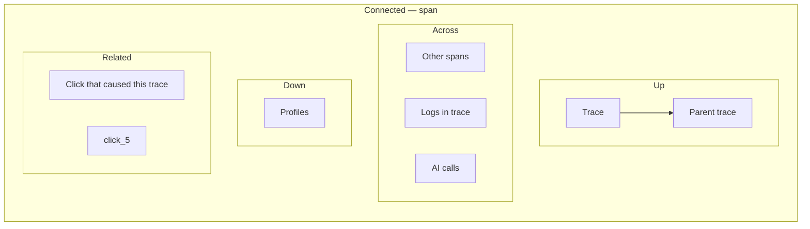
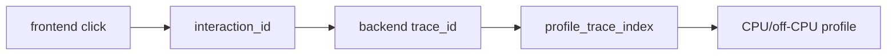

obs-unified is designed around one promise: **built for agentic debugging: one telemetry graph agents can traverse from user action to backend trace, logs, replay, AI cost, MCP tool context, and CPU profile**. The dashboard's Connected Rail is the human-facing version of that same graph; the [MCP server](/docs/mcp-server) is the agent-facing version. This page walks through what the dashboard actually surfaces once instrumentation is in place.

## The Connected Rail

Every detail page in the dashboard mounts a right-side rail with four sections:

- **Up** — the parent entity (trace ← span, session ← usage event, etc.)
- **Across** — sibling signals sharing the same identity key (other spans in the same trace, logs from the same session)
- **Down** — derived data (pprof profile for a trace, off-CPU profile for a span)
- **Related** — non-identity-based neighbors (the click that caused this trace, alerts firing on this service)

When a section has no neighbors, the rail renders an **informative-absence** message explaining *why* — never a silent empty section. The platform's contract is that "no data" should always tell you what's missing and how to populate it.

## Scenario A — alert → trace → flame graph → cohort → session → replay

The headline product test. From a paged alert:

| Step | What you see | What you click | RFCs |
| --- | --- | --- | --- |
| 1 | Alert detail with bound Analysis narrative + exemplar traces | Slowest exemplar trace | 0002, 0006 |
| 2 | Trace waterfall, self-time bars, ⚠ UNINSTRUMENTED + 🔥 PROFILES badges | 🔥 badge on the slow span | 0005, 0006, 0007 |
| 3 | Flame graph filtered to this trace's samples (server-side filter, smaller blob) | "Other traces sampled in this profile (243)" | 0007 |
| 4 | Cohort: all traces touched by this profile, with user attribution | A user from the cohort | 0007, 0006 |
| 5 | Session timeline: user's page views, clicks, traces side-by-side | An rrweb event | 0004, 0006 |
| 6 | Replay scrubbed to the click + Connected Rail: "Trace caused by this click" | Closes the loop back to step 2's trace | 0004, 0006 |

Six clicks across the entire platform. The platform's claim is that every neighbor at every step is on the rail.

> **Illustrative scenario.** The "bound Analysis narrative" in step 1 and the "(243)" other-traces count in step 3 describe a production-shaped incident, not what the seed produces. The sample seed creates one profile trace, and its alert rules fire without a bound analysis (analyses are generated for real alerts that fire against your own traffic). Expect the same click path with smaller numbers.

## Interaction ID to CPU

The browser SDK mints a single `interaction_id` for a frontend action and injects it as `x-obs-interaction` on outbound requests. Backend SDKs copy that value onto the active span as `obs.interaction.id`, and correlated logs, AI calls, or MCP tool context inherit it from the span context.

CPU and off-CPU profiles are joined through traces rather than storing `interaction_id` directly on every sample. If profiling is enabled and samples are labeled with trace IDs, the dashboard can follow:

That is the accurate version of "one ID from frontend to CPU": one interaction ID anchors the user action, and the trace it caused carries the investigation into profiling data.

## Scenario B — AI cost spike → user → session → trace

A different entry point exercising the same identity skeleton:

1. **AI dashboard** shows a cost spike (`SPANS OVER TIME` chart peaks). The Sessions view ranks the heavy spender at the top by cost.
2. **Click the `👤 user-id` chip** on the heavy spender's row → user detail page.
3. **User detail page** shows the user's `Identity` card + a Connected Rail with "Latest session", "Recent traces", "Recent AI calls". The rail surfaces the count-collapsed link for a session with N traces / M AI calls.
4. **Click "Latest session"** → Replay tab scoped to that session, showing the session's interactions linked to their traces.
5. **Click an interaction** → trace waterfall for the trace that click caused. Connected Rail's "Click that caused this trace" closes the loop back to the originating click.

The seed (`pnpm seed`) plants a "Heavy Spender (seed)" user with 8–9 high-cost claude-3-5-haiku calls so this walkthrough is reproducible without writing real AI traffic.

## Scenario B2 — agent action graph → MCP investigation

The agent-facing path starts from the same connected telemetry but uses MCP
tools instead of dashboard clicks:

1. An AI agent calls `recent_traces` or `search_logs` to find the failing path.
2. It calls `connected_signals` to pivot from the trace to related AI calls,
   replay evidence, and action IDs.
3. It calls `get_action` or `get_agent_run` to inspect the Agent Action Graph:
   LLM calls, retrievals, tool calls, governance signals, and eval cases.
4. It reports back with stable dashboard links, action IDs, trace IDs, and the
   relevant logs/replay/profile evidence.

This is why the product copy says "agents can traverse the graph": the graph is
not just visible in the dashboard; it is exposed through read-only MCP tools.

## Scenario C — futex contention via off-CPU flame graph

Validates the kernel-level layer:

1. Trace shows an unexplained pause inside a span (no child spans, on-CPU profile shows little activity).
2. Rail's "Down → 🔥 off-CPU profile" leads to an icicle flame graph that surfaces `futex_wait_queue` ↑ `pthread_mutex_lock` ↑ `inventory_pool::checkout` taking 84% of off-CPU time.
3. Root cause: a single pool-wide mutex serializing every checkout.

This Scenario C off-CPU path currently runs only against the docker-compose demo with [Beyla](https://grafana.com/oss/beyla/) feeding pprof. The dashboard code paths are live; the synthetic seed doesn't generate off-CPU pprof blobs for this path.

## Scenario D — deploy regression → cohort lift → counterfactual verification → guarded rollback

Validates the [AutoSRE causal ontology](/docs/autosre) (RFC 0013) end-to-end across both human dashboard surfaces and MCP agent tools:

1. **Incident triage bundle (`intent: "triage_incident"`):** From a firing checkout alert, the collector separates the deepest failing span (`bundle.autosre.faultLocus`: `unverified_locus`) from ranked `bundle.autosre.candidateChanges`, `contentionCandidates`, and `priorFindings` (including `chg_scenario_d_deploy_241` and `fnd_scenario_d`).
2. **Traffic-normalized cohort lift:** Calling `get_change_blast_radius` compares per-request error rates between `v2.4.1` and `v2.4.0` across minimum sample sizes (`N >= 50` per cohort), confirming `cohortVerdict: "isolated_to_new_version"` (`relationshipCertainty: "inferred"`, `causalProofTier: "cohort_rate_isolated"`) and avoiding the traffic-share fallacy.
3. **Code-path corroboration:** Stack traces on the failing span (`src/checkout/charge.ts`) intersect `touchedPaths` on `v2.4.1`, adding an `"exact"` structural link while keeping causal proof separate from link provenance.
4. **Counterfactual verification:** Recording a finding and attaching a paired baseline-failing run on `v2.4.1` plus one candidate-passing run on `v2.4.0` (the seeder creates one passing run; the counterfactual route accepts `requiredTrials >= 1`) upgrades the finding to `causalProofTier: "counterfactual_verified"`.
5. **Pre-execution remediation gate:** Proposing a rollback (`propose_remediation_action`) checks CAS target state (`expectedCurrentState: { version: "2.4.1" }`), queues high-blast-radius actions in the **Autonomous Review** 1-Click Approval Queue, or issues a single-use `grantToken` for an external runner / agent on low-risk feature-flag flips (`toggle_feature_flag`).

Both `pnpm seed` and `pnpm e2e:autosre` plant this complete Scenario D dataset automatically.

## Per-tab walkthrough

| Tab | What's there | Key rail pivots |
| --- | --- | --- |
| **Health** | Tier-0 analysis tiles (error top offenders, latency outliers, log anomaly summary), recent **Change Markers** (`deploy`, `rollback`, `feature_flag`, `config_change`), and optional LLM narrative | Click a tile → Investigations page; click a change marker → `#/changes/:id` (loads Evidence Bundle Explorer anchored on that change) |
| **Timeline** | Per-session lane of usage / span / log events, grouped by `interaction_id`, plus release/flag change markers | Click an event → trace or replay |
| **Service Map** | Service-to-service edges with SDK / eBPF source filter | Click an edge → traces between those services |
| **Logs** | Histogram + by-service / by-severity breakdown, filterable | Click a log → log detail with rail surfacing parent trace |
| **Investigations** | List of analyses + per-analysis detail page with narrative + evidence + Connected Rail | Rail's "Cited traces" → trace detail |
| **Traces** | Trace list with inline waterfall expansion, self-time visualization, ⚠ + 🔥 badges, span detail drawer | Click a span row → rail with "Click that caused this trace" and dual epistemic badges (`relationshipCertainty` + `causalProofTier`) |
| **Issues** | Trace-level issue grouping by error fingerprint | Click an issue → trace |
| **AI Calls** | Two views — Spans (typed LLM/TOOL/RETRIEVER spans) and Sessions (multi-turn conversation rendering with cost + tokens). User chips are clickable. | Click `👤 user-id` → user detail page; action graph links open `#/actions/:actionId` |
| **Autonomous Review (`/#/autonomous-review` or `/#/remediations`)** | Agent Action Graph risk review plus the **1-Click Remediation Approval Queue** (`pending_human_approval`, `grant_issued`, `completed`, `execution_timed_out`) showing target version CAS diffs and recovery watchdog status (`/#/actions/:id` opens single action detail) | Click **Approve** or **Reject** on a pending proposal; pivot to `#/findings/:id` or `#/incidents/:id` |
| **Evidence (`/#/evidence`)** | Bundle Explorer supporting `trace`, `action`, `agent_run`, `tool_call`, `change`, `finding`, and `incident` anchors (`/#/changes/:id`, `/#/findings/:id`, and `/#/incidents/:id` deep-link directly here) | Inspect compacted findings, `bundle.autosre` triage context, and expand retrieval refs on demand |
| **Replays** | Session list + rrweb player + per-session interactions panel | Click an interaction → trace it caused |
| **Alerts** | Alert rules (evaluated every 5 minutes) + recent firings + bound analyses | Click an alert → bound Analysis → exemplar traces |
| **Usage** | Page views, interactions, top paths, by-country breakdown | Click a session row → timeline |
| **Resources** | Cloudflare worker resource panels + (when populated) Linux host metrics | Click a host → host detail |
| **Projects** | Multi-project routing (ingest keys, dashboard auth) | n/a |

## When you should expect informative absence

The rail is honest about what's missing. You'll see explicit "—" messages when:

- **No interaction_id on a span** — the trace wasn't caused by a browser click (cron, queue consumer, retry). The "Originating click" section explains this.
- **No pprof profile** — the producing service hasn't wired `startProfiler()` or an eBPF agent. The Down section explains how to populate.
- **No rrweb replay** — the session had no real browser to capture chunks. The Replay tab tells you to visit `/playground` and click "Start replay" to capture one.
- **Alert/analysis topic links** — alerts and analyses don't carry identity columns; they relate by topic, not identity. The rail's `Related` section explains this is by design.

These are part of the design — empty data should always be explained, never silent.

## Production deployment caveats

- The migration runner has a `--remote` mode; first-run on a partially-migrated production DB needs manual backfill (see [Installation](/docs/installation#production-deployment)).
- The every-minute analyses cron uses a 90s claim/lease to prevent overlap on long-running LLM narrative passes (RFC 0002 Stage 4 follow-up).
- The pprof receiver returns 422 on decode failure (corrupted blobs surface to the agent instead of landing silently in R2).
- The connected-routes endpoint returns 400 on unknown entity kinds (catches client-side URL building bugs).

## Recent reliability & AutoSRE behavior

The October 2026 updates ([RFC 0013](/docs/autosre)) and earlier May 2026 hardening added several user- and agent-visible guarantees:

- **Orthogonal epistemic badges on the Connected Rail:** Every causal link can display both link provenance (`exact link`, `inferred link`, `temporal heuristic`) and causal proof tier (`fault locus`, `corroborated candidate`, `cohort isolated`, `counterfactual verified`).
- **Traffic-normalized blast radius & noisy-neighbor checks:** `GET /internal/changes/:id/blast-radius` normalizes error rates per request across `service.version` / `vcs.commit.id` / `feature_flag.variant` cohorts and flags shared downstream contention (verdicts `shared_degradation_new_version_aggressor` / `shared_degradation_external_cause`).
- **Pre-execution remediation gate & recovery watchdog:** High-risk production actions require either cohort/counterfactual proof or 1-click human approval in **Autonomous Review**, enforce CAS on `expectedCurrentState`, and track `recoveryStatus` separately from `causalVerificationStatus`.
- **Dashboard loader & stream stability:** Telemetry and AI dashboards abort stale loaders on tab/filter switches, replay chunks load progressively, and live-tail streams enforce project isolation end-to-end.
