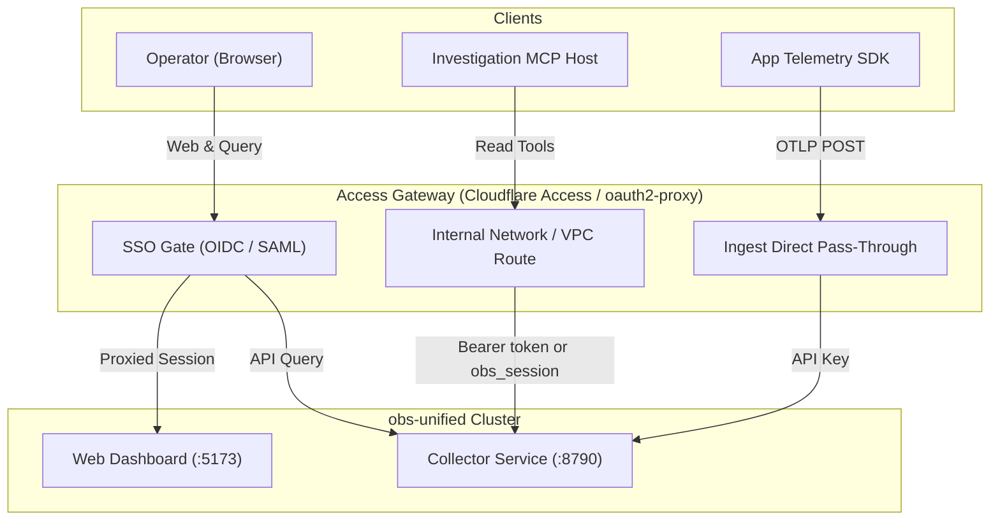

<!-- GENERATED FROM apps/docs/content/docs/ops/identity-access.mdx — DO NOT EDIT DIRECTLY. Run: node scripts/generate-ops-docs.mjs -->

# Identity and external access

This guide covers production identity and perimeter access layer patterns for `obs-unified`. It provides concrete deployment recipes for Cloudflare Access and self-hosted `oauth2-proxy` with Nginx or Caddy. Adaptable configuration templates are provided in [`examples/external-access/`](../../examples/external-access/) for Nginx, Caddy, `oauth2-proxy`, and Cloudflare Tunnel (`cloudflared`). These are adaptable reference templates requiring site-specific domain, secret, and TLS certificate setup before deployment, rather than an all-in-one local Compose harness. For collector and reverse-proxy deployment baselines, see [Production operations](./production.md).

## Architectural realities & boundaries

Before configuring external access, understand how authentication operates in the `obs-unified` stack:

> [!IMPORTANT]
> **Native per-user RBAC and SSO are absent.**
> `obs-unified` does NOT include native per-user Role-Based Access Control (RBAC), user accounts, or native Single Sign-On (SSO / SAML / OIDC).
> - There is no database table for dashboard operators or users.
> - There are no user roles (for example, Viewer vs. Editor vs. Admin).
> - There is no native per-user audit trail or per-user access control within the dashboard.
> - The dashboard relies on a single shared `DASHBOARD_PASSWORD`. Any operator with dashboard access has full administrative visibility into all telemetry projects and can create or revoke ingest keys.
> - `X-Project-Id` is used for multi-project tenant scoping and is validated against known database projects (`packages/obs-collector/src/auth/dashboard-auth.ts`), but this is **not** an authorization boundary or RBAC mechanism: any authenticated dashboard user can switch to any existing project.
> - All per-user access control, identity federation, role enforcement, and access audits must be enforced at an **external access layer**.

### Component access boundaries



1. **Dashboard authentication & programmatic token (`DASHBOARD_PASSWORD`, `DASHBOARD_TOKEN`)**:
   - Grounded in [`packages/obs-collector/src/auth/dashboard-auth.ts`](../../packages/obs-collector/src/auth/dashboard-auth.ts) and [`packages/obs-collector/src/framework/collector.ts`](../../packages/obs-collector/src/framework/collector.ts).
   - Managed in the collector via `dashboardAuth`. Browser login via `POST /auth/login` tests `DASHBOARD_PASSWORD` using constant-time comparison (`timingSafeEqualStr`) and sets an HMAC-SHA256 signed `obs_session` cookie (`{ exp }`, valid for 7 days, `HttpOnly`, `SameSite=Strict`, `Secure` over HTTPS).
   - On `/internal/*` and `GET /auth/check`, the collector accepts either a valid `obs_session` cookie or a programmatic read/admin bearer token (`Authorization: Bearer <DASHBOARD_TOKEN>`, validated in constant time). Programmatic client tokens map directly to this server secret:
     - **CLI client (`@obsunified/cli`)**: uses `OBS_ADMIN_TOKEN` for `keys mint`, `keys list`, and `doctor`; this value must equal the collector server `DASHBOARD_TOKEN`.
     - **MCP server (`@obsunified/mcp-server`)**: uses `OBS_DASHBOARD_TOKEN` for telemetry inspection; this value must equal the collector server `DASHBOARD_TOKEN`.
   - Ingest keys (`INGEST_KEY`, `OBS_INGEST_KEY`) are strictly write-only and cannot read `/internal/*`.
   - When unauthenticated, HTML requests (`Accept: text/html`) redirect to `/dashboard/login`, and API requests without a valid `obs_session` cookie or Bearer token return `401 Unauthorized`.
   - The React dashboard ([`packages/dashboard/src/AuthGate.tsx`](../../packages/dashboard/src/AuthGate.tsx)) queries `GET /auth/check` on mount and renders [`Login.tsx`](../../packages/dashboard/src/Login.tsx) when unauthenticated.
2. **Telemetry ingest API keys (`INGEST_KEY`, `ingest_keys` table)**:
   - Grounded in [`packages/obs-collector/src/auth/ingest-auth.ts`](../../packages/obs-collector/src/auth/ingest-auth.ts) and [`packages/obs-collector/src/lib/projects-store.ts`](../../packages/obs-collector/src/lib/projects-store.ts).
   - Managed via `ingestAuth`. Telemetry producers send `Authorization: Bearer <key>` or `X-API-Key: <key>` to `/v1/*` routes (`POST /v1/traces`, `POST /v1/logs`, `POST /v1/metrics`, `POST /v1/ai`).
   - Ingest keys grant **write-only** access and cannot read dashboard or `/internal/*` query APIs.
3. **Public health endpoint (`/health`)**:
   - Publicly accessible on the collector for load balancer health probes and client clock offset synchronization (`serverTimeMs`). Must remain reachable without SSO redirection.
4. **Investigation MCP boundary (`@obsunified/mcp-server`)**:
   - Grounded in [`packages/mcp-server/src/index.ts`](../../packages/mcp-server/src/index.ts).
   - Read-only investigation server querying `/internal/*` routes.
   - Configure `OBS_DASHBOARD_TOKEN` on the MCP client matching `DASHBOARD_TOKEN` on the collector (or `OBS_SESSION_COOKIE` for ad-hoc browser session reuse). Note that while CLI clients configure `OBS_ADMIN_TOKEN`, MCP configures `OBS_DASHBOARD_TOKEN`; both authenticate against the collector server `DASHBOARD_TOKEN`.
   - The MCP client sends `Authorization: Bearer <OBS_DASHBOARD_TOKEN>` and optional `X-Project-Id`.
   - The MCP client does **not** emit Cloudflare Access service token headers (`CF-Access-Client-Id` or `CF-Access-Client-Secret`). Direct connection across a Cloudflare Access gate without a forwarding proxy is unsupported.
   - Run the MCP server within the trusted internal network or localhost boundary where it can directly reach the collector's port (`http://127.0.0.1:8790` or internal cluster service `http://obs-collector:8790`) using `OBS_DASHBOARD_TOKEN`.
5. **`X-Project-Id` Handling**:
   - The collector requires `X-Project-Id` for multi-project tenant scoping in the dashboard and MCP, validating it against registered project IDs in the database.
   - The reverse proxy **must pass** `X-Project-Id` through to the collector; do not strip it globally.

---

## Route & policy topology

| Path | Backend | Access Layer Policy | Credential | Purpose |
| --- | --- | --- | --- | --- |
| `/health` | Collector `:8790` | Public / Bypass | None | Liveness & clock offset sync |
| `/v1/*` | Collector `:8790` | Bypass SSO | Ingest API Key (`X-API-Key` or `Bearer`) | OTLP spans, logs, metrics, AI calls |
| `/auth/*` | Collector `:8790` | SSO Protected | `obs_session` | Dashboard session management |
| `/internal/*` | Collector `:8790` | SSO / Internal VPC | `obs_session` cookie or Bearer `DASHBOARD_TOKEN` | Telemetry & evidence queries |
| `/` | Dashboard `:5173` | SSO Protected | IdP Session Cookie | React SPA assets |

---

### Logging in and out from scripts

`POST /auth/login` takes a JSON body with the dashboard password and answers with an `obs_session` cookie (`HttpOnly`, `SameSite=Strict`, 7-day `Max-Age`):

```bash
curl -i -X POST http://localhost:5173/auth/login \
  -H 'Content-Type: application/json' \
  -d '{"password":"<DASHBOARD_PASSWORD>"}'
# HTTP/1.1 200 OK
# set-cookie: obs_session=...; Path=/; HttpOnly; SameSite=Strict; Max-Age=604800
# {"success":true}
```

The dashboard origin (`:5173`) proxies `/auth/*` to the collector, so the same call works against `:8790` directly. Add `-c cookies.txt` to save the cookie and `-b cookies.txt` to reuse it on `/internal/*`. A wrong password returns `401`, and repeated failures are rate limited per client IP (set `TRUST_PROXY=true` behind a reverse proxy so that IP is the real client).

**Logout only clears the browser cookie** (`Max-Age=0`). Sessions are stateless signed cookies, so a copy of an issued `obs_session` stays valid until its 7-day expiry or until you rotate `DASHBOARD_PASSWORD`. Rotate the password to invalidate every outstanding session.

### Rotating an ingest key

Ingest keys are project-scoped and can be rotated without downtime:

1. **Mint** a new key: `obs-unified keys mint --project <id> --name <label>` (or `POST /internal/projects/:id/keys`).
2. **Switch clients** to the new `OBS_INGEST_KEY` and redeploy.
3. **Revoke** the old key: `DELETE /internal/projects/:id/keys/:keyId` (find `keyId` with `obs-unified keys list --project <id>`), or `obs-unified keys revoke <keyId>` with CLI 1.2 or newer.

```bash
curl -X DELETE -H "Authorization: Bearer $DASHBOARD_TOKEN" \
  http://localhost:8790/internal/projects/default/keys/<keyId>
```

Revocation is not instant: the collector caches ingest authorization for 60 seconds, so a revoked key can keep ingesting for up to about a minute (observed: accepted at 55 seconds, rejected at 60). A revoked bootstrap key (the one supplied through `INGEST_KEY`) stays revoked after a restart; the collector does not recreate it. Use the newly minted key instead.

## Recipe 1: Cloudflare Access (Zero Trust)

Cloudflare Access protects origin infrastructure with edge-enforced identity policies for human operators while telemetry ingestion bypasses Access and MCP queries run via internal routing.

### Hostname separation

The recommended configuration splits public ingest from authenticated dashboard traffic:
- `obs.example.com`: Protected by Cloudflare Access. Routes `/` to Dashboard `:5173`, `/internal/*` and `/auth/*` to Collector `:8790`.
- `ingest.example.com`: Bypasses Access. Routes `/v1/*` and `/health` directly to Collector `:8790`.

### Step 1: Cloudflare Access application setup

1. In the **Cloudflare Zero Trust Dashboard**, navigate to **Access > Applications**.
2. Click **Add an Application** and select **Self-hosted**.
3. **Application Configuration**:
   - **Application Name**: `obs-unified Dashboard`
   - **Application Domain**: `obs.example.com`
   - **Session Duration**: `24 hours`
4. **Access Policies**:
   - **Policy: Human Operators**: Action `Allow`, Rule type `Include` > `Emails ending in` `@company.com` (or IdP SAML/OIDC Group `engineering-observability`).
5. **MCP Boundary Note**: Because `@obsunified/mcp-server` does not emit `CF-Access-Client-*` headers, do not configure service tokens on `obs.example.com` expecting the standard MCP CLI to traverse it directly. Keep MCP local or on an internal VPC route.

### Step 2: Cloudflare Tunnel (`cloudflared`) configuration

Deploy `cloudflared` using the adaptable template in [`examples/external-access/cloudflared-config.yml`](../../examples/external-access/cloudflared-config.yml). Tunnel UUID, credentials file setup, and ingress hostname configuration are required. Save as `/etc/cloudflared/config.yml`:

```yaml
tunnel: <TUNNEL_UUID>
credentials-file: /etc/cloudflared/<TUNNEL_UUID>.json

ingress:
  # Telemetry Ingest (Direct pass-through, authenticated via Ingest Key)
  - hostname: ingest.example.com
    path: ^/v1/
    service: http://127.0.0.1:8790
  - hostname: ingest.example.com
    path: ^/health$
    service: http://127.0.0.1:8790

  # Dashboard & Query Endpoints (Protected by Cloudflare Access)
  - hostname: obs.example.com
    path: ^/health$
    service: http://127.0.0.1:8790

  - hostname: obs.example.com
    path: ^/(auth|internal)/
    service: http://127.0.0.1:8790
  - hostname: obs.example.com
    service: http://127.0.0.1:5173

  - service: http_status:404
```

---

## Recipe 2: Self-hosted `oauth2-proxy` with Nginx

Deploy `oauth2-proxy` alongside Nginx in Kubernetes or cloud VPCs to gate access against standard OIDC providers (Dex, Keycloak, Okta, Google).

### Step 1: `oauth2-proxy` configuration

Configure `oauth2-proxy` via environment variables (see template in [`examples/external-access/oauth2-proxy.env.example`](../../examples/external-access/oauth2-proxy.env.example)) or `oauth2-proxy.cfg`. Secret setup is required: generate a high-entropy cookie secret and provision OIDC client credentials:

```ini
## /etc/oauth2-proxy/oauth2-proxy.cfg
http_address = "0.0.0.0:4180"
upstreams = [ "static://202" ]

## OIDC Provider Settings
provider = "oidc"
oidc_issuer_url = "https://accounts.google.com"
client_id = "YOUR_OIDC_CLIENT_ID"
client_secret = "YOUR_OIDC_CLIENT_SECRET"

## Cookie Configuration
cookie_name = "_oauth2_proxy"
cookie_secret = "GENERATE_RANDOM_16_24_OR_32_BYTE_STRING="
cookie_secure = true
cookie_httponly = true
cookie_samesite = "lax"
cookie_expire = "168h"

## Authorization Boundaries
email_domains = [ "company.com" ]

## Header Settings
pass_user_headers = true
set_xauthrequest = true

## Skip authentication for public telemetry ingest and health endpoints
skip_auth_routes = [
  "^/health$",
  "^/v1/.*"
]
```

### Step 2: Nginx reverse proxy configuration

Deploy Nginx with the `http_auth_request_module` using the adaptable server fragment template in [`examples/external-access/nginx.conf`](../../examples/external-access/nginx.conf) (or [`examples/external-access/caddy.Caddyfile`](../../examples/external-access/caddy.Caddyfile) for Caddy). TLS certificate provisioning, secret configuration, and upstream host setup are required:

```nginx
upstream collector_backend {
    server 127.0.0.1:8790;
    keepalive 32;
}

upstream dashboard_backend {
    server 127.0.0.1:5173;
    keepalive 16;
}

upstream oauth2_proxy {
    server 127.0.0.1:4180;
}

server {
    listen 443 ssl http2;
    server_name obs.company.com;

    ssl_certificate /etc/ssl/certs/obs.company.com.crt;
    ssl_certificate_key /etc/ssl/private/obs.company.com.key;

    add_header X-Content-Type-Options nosniff always;
    add_header X-Frame-Options SAMEORIGIN always;

    # 1. Health Probe (Bypass auth)
    location = /health {
        proxy_pass http://collector_backend;
        proxy_set_header Host $host;
        proxy_set_header X-Real-IP $remote_addr;
        proxy_set_header X-Forwarded-For $proxy_add_x_forwarded_for;
        proxy_set_header X-Forwarded-Proto $scheme;
    }

    # 2. Telemetry Ingest (Bypass SSO, verified by Collector Ingest Key)
    location /v1/ {
        client_max_body_size 10m;
        proxy_pass http://collector_backend;
        proxy_http_version 1.1;
        proxy_set_header Host $host;
        proxy_set_header X-Real-IP $remote_addr;
        proxy_set_header X-Forwarded-For $proxy_add_x_forwarded_for;
        proxy_set_header X-Forwarded-Proto $scheme;
    }

    # 3. oauth2-proxy Auth Subrequest
    location = /oauth2/auth {
        internal;
        proxy_pass http://oauth2_proxy;
        proxy_pass_request_body off;
        proxy_set_header Content-Length "";
        proxy_set_header X-Original-URI $request_uri;
        proxy_set_header Host $host;
    }

    location /oauth2/ {
        proxy_pass http://oauth2_proxy;
        proxy_set_header Host $host;
        proxy_set_header X-Real-IP $remote_addr;
        proxy_set_header X-Scheme $scheme;
    }

    # 4. Dashboard Authentication Routes (/auth/*) -> Collector (:8790)
    location /auth/ {
        auth_request /oauth2/auth;
        error_page 401 = /oauth2/sign_in?rd=$scheme://$host$request_uri;

        proxy_pass http://collector_backend;
        proxy_http_version 1.1;
        proxy_set_header Host $host;
        proxy_set_header X-Real-IP $remote_addr;
        proxy_set_header X-Forwarded-For $proxy_add_x_forwarded_for;
        proxy_set_header X-Forwarded-Proto $scheme;
        proxy_set_header Cookie $http_cookie;
    }

    # 5. Internal Query APIs (Protected by SSO) -> Collector (:8790)
    location /internal/ {
        auth_request /oauth2/auth;
        error_page 401 = /oauth2/sign_in?rd=$scheme://$host$request_uri;

        auth_request_set $user $upstream_http_x_auth_request_user;
        auth_request_set $email $upstream_http_x_auth_request_email;

        proxy_pass http://collector_backend;
        proxy_http_version 1.1;
        proxy_set_header Host $host;
        proxy_set_header X-Real-IP $remote_addr;
        proxy_set_header X-Forwarded-For $proxy_add_x_forwarded_for;
        proxy_set_header X-Forwarded-Proto $scheme;
        proxy_set_header X-Auth-User $user;
        proxy_set_header X-Auth-Email $email;
        proxy_set_header Cookie $http_cookie;
        proxy_set_header X-Project-Id $http_x_project_id;
    }

    # 6. Dashboard SPA (Protected by SSO) -> Dashboard (:5173)
    location / {
        auth_request /oauth2/auth;
        error_page 401 = /oauth2/sign_in?rd=$scheme://$host$request_uri;

        proxy_pass http://dashboard_backend;
        proxy_set_header Host $host;
        proxy_set_header X-Real-IP $remote_addr;
        proxy_set_header X-Forwarded-For $proxy_add_x_forwarded_for;
        proxy_set_header X-Forwarded-Proto $scheme;
    }
}
```

> Set `TRUST_PROXY=true` on the collector (and only when it is reachable solely through this proxy). Without it the dashboard login rate limit and client-IP handling key on the proxy's address instead of the real client, so one noisy client can lock everyone out of login.

---

## Threat model & security boundaries

| Threat Vector | Code Grounding & Vulnerability | External Mitigation Required |
| :--- | :--- | :--- |
| **Shared Password Compromise** | [`dashboard-auth.ts`](../../packages/obs-collector/src/auth/dashboard-auth.ts) uses a single static `DASHBOARD_PASSWORD`. If leaked, an attacker has full access to all projects, traces, AI calls, and key creation. | Enforce MFA and SSO at perimeter (Cloudflare Access / OIDC). Isolate dashboard to corporate IP/VPN/Identity boundaries. |
| **Project Key Escalation** | Any authenticated dashboard session can call `POST /internal/projects/:id/keys` or `DELETE /internal/projects/:id/keys/:keyId`. | Perimeter layer must restrict access to trusted staff only. Audit proxy logs for calls to `/internal/projects/*/keys`. |
| **Ingest Denial of Service / Storage Exhaustion** | `/v1/*` accepts large telemetry payloads (traces, pprof profiles, replays). An attacker with an ingest key could flood S3/Postgres storage. | Configure reverse proxy `client_max_body_size 10m` and rate-limiting (`limit_req_zone`) on `/v1/*`. Set S3 lifecycle expiration to 72 hours. |
| **MCP Secret Exposure & Misconfiguration** | `@obsunified/mcp-server` requires `OBS_DASHBOARD_TOKEN` (or `OBS_SESSION_COOKIE`) to read from `/internal/*`. It does not support Cloudflare Access service token headers. | Run MCP inside the trusted network boundary. Do not expose `/internal/*` publicly under the assumption that Cloudflare Access service tokens will work without proxy translation. |

---

## Secrets management checklist

1. **`DASHBOARD_PASSWORD`**: High-entropy secret stored in your secret manager.
2. **`DASHBOARD_TOKEN`**: Distinct high-entropy bearer token for programmatic read/admin access (`@obsunified/mcp-server` via `OBS_DASHBOARD_TOKEN` and `@obsunified/cli` via `OBS_ADMIN_TOKEN`).
3. **`INGEST_KEY`**: Rotatable write key provisioned per project in the collector database.
4. **`cookie_secret` (`oauth2-proxy`)**: 16, 24, or 32-byte base64 string for AES cookie encryption.
5. **Investigation MCP**: Store `OBS_DASHBOARD_TOKEN` (matching `DASHBOARD_TOKEN`, or `OBS_SESSION_COOKIE`) securely and route MCP connections directly to the internal collector port.

---

## Operational validation

1. **Verify `/health` is public**:
   ```bash
   # On public ingest origin (Cloudflare topology):
   curl -i https://ingest.example.com/health
   # On dashboard origin (with Cloudflare Access bypass policy):
   curl -i https://obs.example.com/health
   # Or on single-domain reverse proxy (Nginx / Caddy):
   curl -i https://obs.company.com/health
   # Expected: 200 OK, JSON containing { status: "ok", serverTimeMs: ... }
   ```
2. **Verify ingest authentication at collector**:
   ```bash
   # Missing API key (rejected by collector ingest auth):
   curl -i -X POST https://ingest.example.com/v1/traces \
     -H "Content-Type: application/json" -d '{"resourceSpans":[]}'
   # Expected: 401 Unauthorized

   # Valid API key:
   curl -i -X POST https://ingest.example.com/v1/traces \
     -H "Authorization: Bearer <INGEST_KEY>" \
     -H "Content-Type: application/json" -d '{"resourceSpans":[]}'
   # Expected: 200 OK
   ```
3. **Verify unauthenticated dashboard redirects to SSO**:
   ```bash
   curl -i https://obs.example.com/internal/telemetry/overview
   # Expected: 302 Redirect to IdP / 401 Unauthorized
   ```
4. **Verify authenticated dashboard session with project scoping**:
   ```bash
   # With SSO session but without obs_session cookie:
   curl -i https://obs.example.com/internal/telemetry/overview \
     -H "Cookie: _oauth2_proxy=<OAUTH_COOKIE>"
   # Expected: 401 Unauthorized from collector

   # With both SSO session and obs_session cookie:
   curl -i https://obs.example.com/internal/telemetry/overview \
     -H "Cookie: _oauth2_proxy=<OAUTH_COOKIE>; obs_session=<OBS_SESSION>" \
     -H "X-Project-Id: default"
   # Expected: 200 OK
   ```
5. **Verify programmatic MCP bearer token access**:
   ```bash
   curl -i https://obs.example.com/internal/telemetry/overview \
     -H "Authorization: Bearer <DASHBOARD_TOKEN>" \
     -H "X-Project-Id: default"
   # Expected: 200 OK

   # Local / internal MCP host connectivity:
   export OBS_COLLECTOR_URL="http://127.0.0.1:8790"
   export OBS_DASHBOARD_TOKEN="<VALID_DASHBOARD_TOKEN>"
   obs-unified-mcp
   ```
