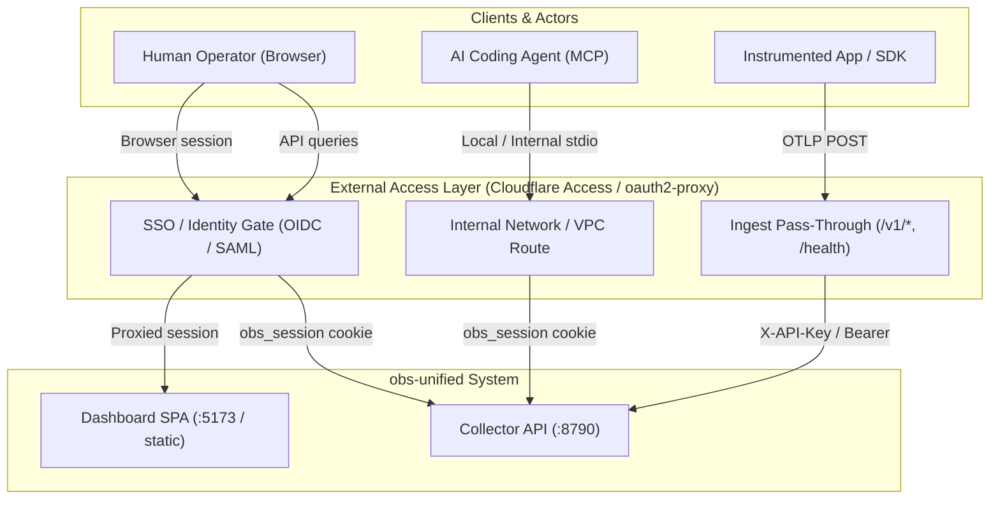

# Production Identity & External Access Layer Recipes

This document provides deployment patterns and adaptable templates for securing `obs-unified` with an external identity and access management layer (such as Cloudflare Access or `oauth2-proxy`). Adaptable configuration templates for Nginx, Caddy, `oauth2-proxy`, and Cloudflare Tunnel are provided in [`examples/external-access/`](../../examples/external-access/). These files are adaptable templates requiring site-specific domain configuration, TLS certificate provisioning, and secret setup rather than an out-of-the-box runnable Compose harness.

---

## 1. Architectural Realities & Code Grounding

Before deploying an external access layer, understand how authentication and routing actually work in the `obs-unified` codebase:

### Absolute Absence of Native Per-User RBAC & SSO

> [!IMPORTANT]
> **`obs-unified` does NOT include native per-user Role-Based Access Control (RBAC), user accounts, or native Single Sign-On (SSO / SAML / OIDC).**
> - There is no database table for dashboard operators or users.
> - There are no user roles (e.g., Viewer vs. Editor vs. Admin).
> - There is no native per-user audit trail or per-user access control within the dashboard.
> - Once authenticated, an operator has full administrative visibility across all projects and can issue or revoke project ingest keys.
> - `X-Project-Id` is used for multi-project tenant scoping and is validated against known database projects (`packages/obs-collector/src/auth/dashboard-auth.ts:181-190`), but this is **not** an authorization boundary or RBAC mechanism: any authenticated dashboard user can switch to any existing project.

All identity federation, user authentication, role enforcement, and access audits must be handled by an **external access layer** (such as Cloudflare Access, Okta, `oauth2-proxy`, or an API gateway) placed in front of `obs-unified`.

### Actual Code Implementation & Boundaries

The platform separates access into distinct concerns:



1. **Dashboard Shared Secret (`DASHBOARD_PASSWORD`)**:
   - Grounded in [`packages/obs-collector/src/auth/dashboard-auth.ts`](../../packages/obs-collector/src/auth/dashboard-auth.ts) and [`packages/obs-collector/src/framework/collector.ts`](../../packages/obs-collector/src/framework/collector.ts).
   - Single shared secret defined via the `DASHBOARD_PASSWORD` environment variable.
   - Login endpoint (`POST /auth/login`) tests the password using constant-time comparison (`timingSafeEqualStr`) and issues a signed `obs_session` cookie (`HMAC-SHA256` payload containing `{ exp }`, valid for 7 days, `HttpOnly`, `SameSite=Strict`, `Secure` over HTTPS).
   - The `dashboardAuth.middleware` protects `/internal/*` and `/dashboard/*`.
   - **Crucial collector constraint**: On `/internal/*`, `dashboardAuth` checks **only the `obs_session` cookie**. It does not accept bearer tokens or API keys on `/internal/*`.
     - If unauthenticated, HTML requests (`Accept: text/html`) redirect to `/dashboard/login`.
     - API requests without a valid `obs_session` cookie return `401 Unauthorized`.
   - The React dashboard ([`packages/dashboard/src/AuthGate.tsx`](../../packages/dashboard/src/AuthGate.tsx)) queries `GET /auth/check` on mount and renders [`Login.tsx`](../../packages/dashboard/src/Login.tsx) when anon.

2. **Telemetry Ingest API Keys (`INGEST_KEY`, `ingest_keys` table)**:
   - Grounded in [`packages/obs-collector/src/auth/ingest-auth.ts`](../../packages/obs-collector/src/auth/ingest-auth.ts) and [`packages/obs-collector/src/lib/projects-store.ts`](../../packages/obs-collector/src/lib/projects-store.ts).
   - Validated on `/v1/*` routes.
   - Supplied via `Authorization: Bearer <key>` or `X-API-Key: <key>`.
   - Ingest keys grant **write-only** access to telemetry ingestion (`POST /v1/traces`, `POST /v1/logs`, `POST /v1/metrics`, `POST /v1/ai`).
   - Ingest keys are **not** accepted for reading `/internal/*` routes when `dashboardAuth` is active.

3. **Public Unauthenticated Routes**:
   - `/health`: Health status and clock offset synchronization (`serverTimeMs`). Must remain publicly reachable for preflight and readiness probes without SSO redirection.

4. **Investigation MCP Server Boundaries (`@obsunified/mcp-server`)**:
   - Grounded in [`packages/mcp-server/src/index.ts`](../../packages/mcp-server/src/index.ts).
   - `readConfig()` reads one of: `OBS_DASHBOARD_TOKEN`, `OBS_INGEST_KEY`, or `OBS_SESSION_COOKIE`.
   - **Grounding reality**:
     - When the collector runs with `dashboardAuth` (standard production setup), `/internal/*` checks **only** the `obs_session` cookie. Neither `OBS_INGEST_KEY` nor `OBS_DASHBOARD_TOKEN` provides native read access to `/internal/*`. Only `OBS_SESSION_COOKIE` is valid against a collector running `dashboardAuth`.
     - The current `@obsunified/mcp-server` client **does not emit Cloudflare Access service token headers** (`CF-Access-Client-Id` or `CF-Access-Client-Secret`). It only sends standard HTTP headers (`Accept`, `Authorization`, `Cookie`, `X-Project-Id`).
     - Therefore, attempting to route remote `@obsunified/mcp-server` traffic through a Cloudflare Access gate without a local forwarding proxy that injects Access headers is **unsupported**.
     - **Verified MCP Deployment Pattern**: Run `@obsunified/mcp-server` within the trusted internal network or localhost boundary where it can directly reach the collector's internal port (`http://127.0.0.1:8790` or internal cluster service `http://obs-collector:8790`) using `OBS_SESSION_COOKIE`.

5. **`X-Project-Id` Handling**:
   - The collector requires `X-Project-Id` to switch project views in the dashboard and to scope MCP queries.
   - The collector validates `X-Project-Id` against registered project IDs in the database.
   - Reverse proxies **must pass** `X-Project-Id` through to the collector; do not strip it globally.

---

## 2. Route & Perimeter Boundary Matrix

| Path Pattern | Origin Service | Perimeter Access Policy | Application Credential | Purpose |
| :--- | :--- | :--- | :--- | :--- |
| `/health` | Collector (`:8790`) | Public / Unrestricted | None | Health check & clock sync |
| `/v1/*` | Collector (`:8790`) | Public / Bypass SSO | Ingest Key (`X-API-Key` or `Bearer`) | OTLP telemetry ingestion from apps |
| `/auth/*` | Collector (`:8790`) | SSO Protected | Handled by SPA / Collector | Session creation & status checks |
| `/internal/*` | Collector (`:8790`) | SSO Protected (Human) / Internal Network (MCP) | `obs_session` Cookie | Dashboard data queries & evidence retrieval |
| `/` & Static Assets | Dashboard (`:5173`) | SSO Protected | External IdP session | React dashboard interface |

---

## 3. Recipe 1: Cloudflare Access (Zero Trust)

Cloudflare Access provides edge identity verification for human users. Telemetry ingestion bypasses Access, and MCP queries run via internal routing.

### Hostname Separation Strategy

The cleanest production topology splits public telemetry ingestion from protected dashboard traffic:
1. `obs.example.com`: Protected by Cloudflare Access. Houses the Dashboard and internal query APIs (`/internal/*`, `/auth/*`).
2. `ingest.example.com`: Bypasses Cloudflare Access. Houses telemetry ingestion endpoints (`/v1/*`, `/health`). Ingest keys protect `/v1/*`.

### Step 1: Cloudflare Access Application Setup

1. In the **Cloudflare Zero Trust Dashboard**, navigate to **Access > Applications**.
2. Click **Add an Application** and select **Self-hosted**.
3. **Application Configuration**:
   - **Application Name**: `obs-unified Dashboard`
   - **Application Domain**: `obs.example.com`
   - **Session Duration**: `24 hours`
4. **Access Policies**:
   - **Policy: Human Operators**
     - Action: `Allow`
     - Rule type: `Include` > `Emails ending in` `@company.com` (or IdP SAML/OIDC Group `engineering-observability`).
5. **MCP Boundary Note**: Because `@obsunified/mcp-server` does not emit `CF-Access-Client-*` headers, do not configure service tokens on `obs.example.com` expecting the standard MCP CLI to traverse it directly. Keep MCP local or on an internal VPC route.

### Step 2: Cloudflare Tunnel (`cloudflared`) Configuration

Deploy `cloudflared` adjacent to the stack using the adaptable template in [`examples/external-access/cloudflared-config.yml`](../../examples/external-access/cloudflared-config.yml). Tunnel UUID, credential file setup, and production hostname configuration are required. Save as `/etc/cloudflared/config.yml`:

```yaml
tunnel: <TUNNEL_UUID>
credentials-file: /etc/cloudflared/<TUNNEL_UUID>.json

ingress:
  # Ingest Hostname (Bypasses Access, protected by Ingest Key)
  - hostname: ingest.example.com
    path: ^/v1/
    service: http://127.0.0.1:8790
  - hostname: ingest.example.com
    path: ^/health$
    service: http://127.0.0.1:8790

  # Dashboard & Query Hostname (Protected by Cloudflare Access)
  - hostname: obs.example.com
    path: ^/health$
    service: http://127.0.0.1:8790

  - hostname: obs.example.com
    path: ^/(auth|internal)/
    service: http://127.0.0.1:8790
  - hostname: obs.example.com
    service: http://127.0.0.1:5173

  # Catch-all
  - service: http_status:404
```

---

## 4. Recipe 2: Self-Hosted `oauth2-proxy` with Nginx

For Kubernetes or cloud VPC deployments without Cloudflare, deploy `oauth2-proxy` in front of Nginx.

### Step 1: `oauth2-proxy` Configuration

Configure `oauth2-proxy` via environment variables (see template in [`examples/external-access/oauth2-proxy.env.example`](../../examples/external-access/oauth2-proxy.env.example)) or `oauth2-proxy.cfg`. Secret setup is required: generate a high-entropy cookie secret and provision OIDC client credentials:

```ini
## /etc/oauth2-proxy/oauth2-proxy.cfg
http_address = "0.0.0.0:4180"
upstreams = [ "static://202" ]

## OIDC Provider Settings
provider = "oidc"
oidc_issuer_url = "https://accounts.google.com"
client_id = "YOUR_OIDC_CLIENT_ID"
client_secret = "YOUR_OIDC_CLIENT_SECRET"

## Cookie Configuration
cookie_name = "_oauth2_proxy"
cookie_secret = "GENERATE_RANDOM_16_24_OR_32_BYTE_STRING="
cookie_secure = true
cookie_httponly = true
cookie_samesite = "lax"
cookie_expire = "168h"

## Authorization Boundaries
email_domains = [ "company.com" ]

## Header Settings
pass_user_headers = true
set_xauthrequest = true

## Skip authentication for public telemetry ingest and health endpoints
skip_auth_routes = [
  "^/health$",
  "^/v1/.*"
]
```

### Step 2: Nginx Gateway Configuration

Deploy Nginx with the `http_auth_request_module` using the adaptable server fragment template in [`examples/external-access/nginx.conf`](../../examples/external-access/nginx.conf) (or [`examples/external-access/caddy.Caddyfile`](../../examples/external-access/caddy.Caddyfile) for Caddy). TLS certificate provisioning and upstream host configuration are required:

```nginx
# /etc/nginx/conf.d/obs-external-access.conf

upstream collector_backend {
    server 127.0.0.1:8790;
    keepalive 32;
}

upstream dashboard_backend {
    server 127.0.0.1:5173;
    keepalive 16;
}

upstream oauth2_proxy {
    server 127.0.0.1:4180;
}

server {
    listen 443 ssl http2;
    server_name obs.company.com;

    ssl_certificate /etc/ssl/certs/obs.company.com.crt;
    ssl_certificate_key /etc/ssl/private/obs.company.com.key;

    # Security Headers
    add_header X-Content-Type-Options nosniff always;
    add_header X-Frame-Options SAMEORIGIN always;

    # -------------------------------------------------------------------------
    # 1. Health Check (Public / Bypasses auth)
    # -------------------------------------------------------------------------
    location = /health {
        proxy_pass http://collector_backend;
        proxy_set_header Host $host;
        proxy_set_header X-Real-IP $remote_addr;
        proxy_set_header X-Forwarded-For $proxy_add_x_forwarded_for;
        proxy_set_header X-Forwarded-Proto $scheme;
    }

    # -------------------------------------------------------------------------
    # 2. Telemetry Ingest (Bypasses SSO; Collector requires Ingest Key)
    # -------------------------------------------------------------------------
    location /v1/ {
        client_max_body_size 10m;

        proxy_pass http://collector_backend;
        proxy_http_version 1.1;
        proxy_set_header Host $host;
        proxy_set_header X-Real-IP $remote_addr;
        proxy_set_header X-Forwarded-For $proxy_add_x_forwarded_for;
        proxy_set_header X-Forwarded-Proto $scheme;
        # Nginx forwards client request headers (Authorization, X-API-Key, X-Project-Id) by default
    }

    # -------------------------------------------------------------------------
    # 3. oauth2-proxy Authentication Subrequest
    # -------------------------------------------------------------------------
    location = /oauth2/auth {
        internal;
        proxy_pass http://oauth2_proxy;
        proxy_pass_request_body off;
        proxy_set_header Content-Length "";
        proxy_set_header X-Original-URI $request_uri;
        proxy_set_header Host $host;
    }

    location /oauth2/ {
        proxy_pass http://oauth2_proxy;
        proxy_set_header Host $host;
        proxy_set_header X-Real-IP $remote_addr;
        proxy_set_header X-Scheme $scheme;
    }

    # -------------------------------------------------------------------------
    # 4. Internal Query Endpoints (Protected by oauth2-proxy)
    # -------------------------------------------------------------------------
    location /internal/ {
        auth_request /oauth2/auth;
        error_page 401 = /oauth2/sign_in?rd=$scheme://$host$request_uri;

        auth_request_set $user $upstream_http_x_auth_request_user;
        auth_request_set $email $upstream_http_x_auth_request_email;

        proxy_pass http://collector_backend;
        proxy_http_version 1.1;
        proxy_set_header Host $host;
        proxy_set_header X-Real-IP $remote_addr;
        proxy_set_header X-Forwarded-For $proxy_add_x_forwarded_for;
        proxy_set_header X-Forwarded-Proto $scheme;
        proxy_set_header X-Auth-User $user;
        proxy_set_header X-Auth-Email $email;

        # Forward cookies (contains obs_session for collector) and X-Project-Id
        proxy_set_header Cookie $http_cookie;
        proxy_set_header X-Project-Id $http_x_project_id;
    }

    # -------------------------------------------------------------------------
    # 5. Dashboard Authentication Routes (/auth/*)
    # -------------------------------------------------------------------------
    location /auth/ {
        auth_request /oauth2/auth;
        error_page 401 = /oauth2/sign_in?rd=$scheme://$host$request_uri;

        proxy_pass http://collector_backend;
        proxy_set_header Host $host;
        proxy_set_header X-Real-IP $remote_addr;
        proxy_set_header X-Forwarded-For $proxy_add_x_forwarded_for;
        proxy_set_header X-Forwarded-Proto $scheme;
        proxy_set_header Cookie $http_cookie;
    }

    # -------------------------------------------------------------------------
    # 6. Dashboard SPA Frontend
    # -------------------------------------------------------------------------
    location / {
        auth_request /oauth2/auth;
        error_page 401 = /oauth2/sign_in?rd=$scheme://$host$request_uri;

        proxy_pass http://dashboard_backend;
        proxy_set_header Host $host;
        proxy_set_header X-Real-IP $remote_addr;
        proxy_set_header X-Forwarded-For $proxy_add_x_forwarded_for;
        proxy_set_header X-Forwarded-Proto $scheme;

        # SPA client routing fallback is handled upstream by dashboard_backend
    }
}
```

---

## 5. Threat Model & Security Boundaries Grounded in Code

| Threat Vector | Code Grounding & Vulnerability | External Mitigation Required |
| :--- | :--- | :--- |
| **Shared Password Compromise** | [`dashboard-auth.ts`](../../packages/obs-collector/src/auth/dashboard-auth.ts) uses a single static `DASHBOARD_PASSWORD`. If leaked, an attacker has full access to all projects, traces, AI calls, and key creation. | Enforce MFA and SSO at perimeter (Cloudflare Access / OIDC). Isolate dashboard to corporate IP/VPN/Identity boundaries. |
| **Project Key Escalation** | Any authenticated dashboard session can call `POST /internal/projects/:id/keys` or `DELETE /internal/projects/:id/keys/:keyId`. | Perimeter layer must restrict access to trusted staff only. Audit proxy logs for calls to `/internal/projects/*/keys`. |
| **Ingest Denial of Service / Storage Exhaustion** | `/v1/*` accepts large telemetry payloads (traces, pprof profiles, replays). An attacker with an ingest key could flood S3/Postgres storage. | Configure reverse proxy `client_max_body_size 10m` and rate-limiting (`limit_req_zone`) on `/v1/*`. Set S3 lifecycle expiration to 72 hours. |
| **MCP Secret Exposure & Misconfiguration** | `@obsunified/mcp-server` requires `OBS_SESSION_COOKIE` to read from `/internal/*`. It does not support Cloudflare Access service token headers. | Run MCP inside the trusted network boundary. Do not expose `/internal/*` publicly under the assumption that bearer tokens or service tokens will work without proxy translation. |

---

## 6. Operational Validation Runbook

Run these checks to verify that the external access layer correctly enforces identity boundaries:

### Step 1: Verify Health Probe Pass-Through
```bash
# Ingest origin health probe (Cloudflare topology):
curl -i https://ingest.example.com/health
# Dashboard origin health probe (bypasses Cloudflare Access via policy):
curl -i https://obs.example.com/health
# Single-domain reverse proxy topology (Nginx / Caddy):
curl -i https://obs.company.com/health
# Expected: 200 OK, JSON containing { status: "ok", serverTimeMs: ... }
```

### Step 2: Verify Ingest Authentication at Collector
```bash
# Target public ingest host (e.g., https://ingest.example.com or https://obs.company.com)
# Missing API key:
curl -i -X POST https://ingest.example.com/v1/traces \
  -H "Content-Type: application/json" \
  -d '{"resourceSpans":[]}'
# Expected: 401 Unauthorized (Bypasses SSO, rejected by collector ingest auth)

# Valid API key:
curl -i -X POST https://ingest.example.com/v1/traces \
  -H "Authorization: Bearer <INGEST_KEY>" \
  -H "Content-Type: application/json" \
  -d '{"resourceSpans":[]}'
# Expected: 200 OK (Accepted by collector)
```

### Step 3: Verify Unauthenticated Access to Protected Routes
```bash
curl -i https://obs.example.com/internal/telemetry/overview
# Expected: 302 Redirect to SSO Login or 401/403 Forbidden from Access Layer
```

### Step 4: Verify Dashboard Session Enforcement on `/internal/*`
```bash
# With valid SSO session but without obs_session cookie:
curl -i https://obs.example.com/internal/telemetry/overview \
  -H "Cookie: _oauth2_proxy=<VALID_OAUTH_COOKIE>"
# Expected: 401 Unauthorized from collector (collector requires obs_session cookie)

# With both SSO session and obs_session cookie:
curl -i https://obs.example.com/internal/telemetry/overview \
  -H "Cookie: _oauth2_proxy=<VALID_OAUTH_COOKIE>; obs_session=<VALID_OBS_COOKIE>" \
  -H "X-Project-Id: default"
# Expected: 200 OK
```

### Step 5: Verify Investigation MCP Local Connectivity
```bash
# On the internal host running the collector:
export OBS_COLLECTOR_URL="http://127.0.0.1:8790"
export OBS_SESSION_COOKIE="<VALID_OBS_COOKIE>"
obs-unified-mcp
```
