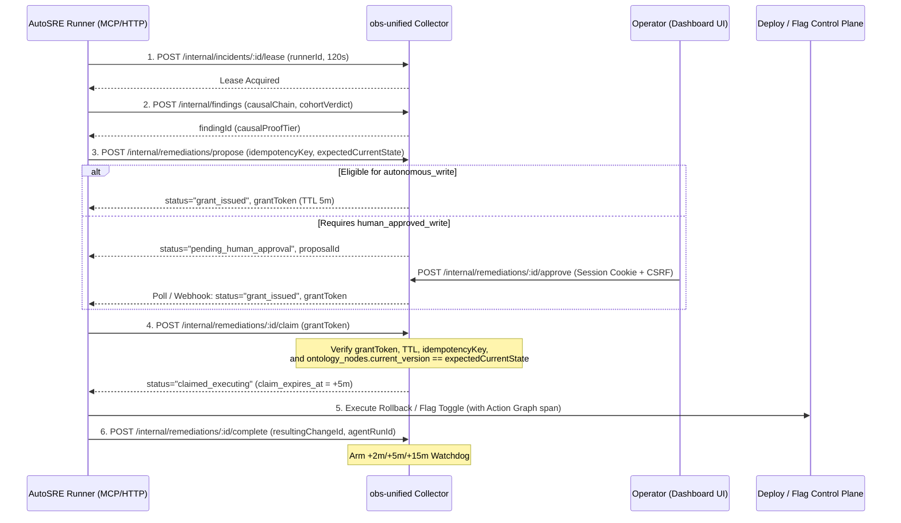

# RFC 0013: AutoSRE causal ontology, change correlation, and incident memory

- **Status:** Draft (Rev 4 — Complete End-to-End Specification)
- **Author:** @sawanruparel
- **Created:** 2026-10-14
- **Updated:** 2026-10-15
- **Parent:** [RFC 0011 — Evidence retrieval layer](file:///Users/sawan/projects/obs-unified/monorepo/rfcs/0011-evidence-retrieval-layer.md)
- **Depends on:**
  [RFC 0002 — Application-aware analyses](file:///Users/sawan/projects/obs-unified/monorepo/rfcs/0002-application-aware-analyses.md),
  [RFC 0006 — Connected rail](file:///Users/sawan/projects/obs-unified/monorepo/rfcs/0006-connected-rail.md),
  [RFC 0008 — Storage interface refactor](file:///Users/sawan/projects/obs-unified/monorepo/rfcs/0008-storage-interface.md),
  [RFC 0010 — Agent action graph](file:///Users/sawan/projects/obs-unified/monorepo/rfcs/0010-agent-action-graph.md),
  [RFC 0011 — Evidence retrieval layer](file:///Users/sawan/projects/obs-unified/monorepo/rfcs/0011-evidence-retrieval-layer.md),
  [RFC 0012 — Unified messaging](file:///Users/sawan/projects/obs-unified/monorepo/rfcs/0012-unified-messaging.md)
- **Companion:**
  [EvidenceReference contract](file:///Users/sawan/projects/obs-unified/monorepo/docs/spec/evidence-reference.md),
  [Agent Action Graph](file:///Users/sawan/projects/obs-unified/monorepo/docs/agent-action-graph.md),
  [MCP terminology](file:///Users/sawan/projects/obs-unified/monorepo/docs/mcp.md),
  [AI debugging impact backlog](file:///Users/sawan/projects/obs-unified/monorepo/docs/ai-debugging-impact-backlog.md),
  [AI debugging scenario proof format](file:///Users/sawan/projects/obs-unified/monorepo/docs/ai-debugging-scenario-proof.md)
- **Target:** `@obsunified/types`, `@obsunified/collector`, `@obsunified/mcp-server`,
  `@obsunified/telemetry-sdk`, `@obsunified/analytics-sdk`, `@obsunified/sdk`,
  `@obsunified/cli`, `@obsunified/dashboard`, `@obsunified/messaging`, `skills`, docs

---

## Summary

Extend `obs-unified` from an interactive agent-debugging stack into a
**closed-loop AutoSRE system** capable of autonomous fault localization,
cohort/contention attribution, pre-execution governed remediation, paired
counterfactual verification, and durable incident memory.

Traditional AIOps platforms failed because they conflated observational
correlation with causal proof, leading to hallucinated root causes and unsafe
automation. Conversely, a strictly zero-heuristic system goes blind across
uninstrumented third-party boundaries, misses cross-trace "noisy neighbor"
resource contention, and cannot triage emergent load-dependent failures.

This RFC introduces a **Three-Stage Epistemic & Governance Pipeline** that
strictly separates **Relationship Certainty** (how sure we are two entities are
linked in execution or code) from **Causal Proof** (how sure we are that $X$
*caused* symptom $Y$), enforced by a **Pre-Execution Remediation Authorization
Boundary**:

1. **Stage 1 — High-Recall Candidate Discovery (Explicitly Scoped Heuristics):**
   Surface candidate fault loci and changes across uninstrumented boundaries,
   temporal deploy windows, inferred version/flag transitions, dependency
   blackouts, and **cross-trace shared-resource contention** (noisy neighbors,
   DB locks, rate-limit exhaustion).
2. **Stage 2 — Causal Attribution & Paired Counterfactual Proof:**
   Evaluate candidates using **traffic-normalized cohort rate lift** (comparing
   per-request failure rates and latency across concurrent versions/flags with
   minimum sample gates), **cross-cohort noisy-neighbor propagation checks**, and
   **paired AB/BA counterfactual reproducers** (requiring the exact same
   reproducer to *fail* with matching fingerprint on the implicated state and
   *pass* on the baseline/patched state).
3. **Stage 3 — Pre-Execution Authorization & Watchdog Verification:**
   Enforce action-specific authorization *before* any external runner mutates
   production via leased, idempotent **`RemediationGrant`s** bound to target
   environment, expected current version, and verifiable human approval records.
   Track post-action **Service Recovery** separately from **Causal Verification**.

```mermaid
flowchart LR
  subgraph Stage1 ["Stage 1: Candidate Discovery (High Recall)"]
    H1["Temporal Change Windows"]
    H2["Cross-Trace Contention Joins"]
    H3["Trace Call-Tree Fault Locus"]
    H4["Directed Topology Graph (Cycle-Safe)"]
  end

  subgraph Stage2 ["Stage 2: Causal Attribution & Proof"]
    D1["Traffic-Normalized Cohort Rate Lift"]
    D2["Noisy-Neighbor vs Cohort Isolation"]
    D3["Paired Fail→Pass Counterfactual Eval"]
  end

  subgraph Stage3 ["Stage 3: Pre-Execution Gate & Watchdog"]
    G1["Action-Specific Remediation Proposal"]
    G2["Pre-Execution Grant + Optimistic Version Lock"]
    G3["Watchdog: Service Recovery vs Cause Verified"]
  end

  Stage1 -->|"Relationship Certainty\n(exact | inferred | heuristic)"| Stage2
  Stage2 -->|"Causal Proof Tier"| Stage3
```



---

## Motivation & Core Architectural Invariants

To reach AutoSRE safely, the system enforces five non-negotiable invariants:

1. **Structural Overlap $\neq$ Causal Proof:** A failing stack frame in
   `src/payments/retry.ts` overlapping a deploy that touched
   `src/payments/retry.ts` proves **exact structural overlap**
   (`relationshipCertainty: "exact"`), *not* that the deploy caused the failure.
   Similarly, the deepest failing span in a trace identifies the **fault locus**
   (where the error surfaced), not necessarily its root cause (which could be bad
   caller input or upstream config).
2. **Error Rate Lift $\neq$ Raw Error Share:** Comparing raw error counts across
   versions is invalid when traffic is split unevenly (e.g., 95% on `v2.4.1`, 5%
   on `v2.4.0`). Attribution must compare **per-request failure rates** with
   minimum sample thresholds, and must recognize that when *both* versions fail
   concurrently after a deploy, the new deploy may still be the cause via shared
   resource exhaustion (noisy neighbor).
3. **Service Recovery $\neq$ Verified Root Cause:** If errors stop after a
   rollback, load may simply have dropped. Post-remediation telemetry watchdogs
   measure **Service Recovery** (requiring comparable traffic volume), whereas
   `counterfactual_verified` requires a **paired reproducer** that deterministically
   *fails* against the implicated state and *passes* against the baseline/fix
   state under recorded conditions.
4. **Governance Must Precede Execution:** Rejecting an `InvestigationFinding`
   *after* a runner already rolled back production is not a safety gate.
   Remediation requires a **pre-execution proposal → policy/human grant →
   version-checked claim** protocol with durable incident leases so multiple
   alerts never trigger duplicate rollbacks.
5. **Canonical Environment-Scoped Identity & Dialect-Portable Indexing:**
   Services, databases, queues, and hosts must never collide across `staging`
   and `prod` or across distinct clusters sharing a logical database name. All
   cohort and contention joins must run against indexed, denormalized columns
   rather than full-table JSON scans so they work identically across D1/SQLite
   and PostgreSQL.

---

## Proposed Design

### 1. Canonical Resource Identity & Cycle-Safe Directed Topology Graph

#### A. Canonical Node Identity (`canonical_node_id`)

To prevent merging unrelated environments (`staging` vs `prod`) or distinct
database instances that share a logical name (e.g., two Postgres clusters both
hosting a database named `orders`), every `OntologyNode` is keyed by
`(project_id, environment, id)` where `id` is a canonical URI-shaped identifier
built from normalized physical scope attributes:

| Node Kind | Canonical ID Format | Source Attributes (OTel / SDK) |
| --- | --- | --- |
| `service` | `service:{env}:{namespace}:{service.name}` | `deployment.environment.name` (or `deployment.environment`, default `"default"`), `service.namespace` (default `"default"`), `service.name` |
| `endpoint` | `endpoint:{env}:{namespace}:{service.name}:{method_or_rpc}:{route}` | `http.request.method` / `http.method` / `rpc.method`, `http.route` / normalized `span_name` |
| `database` | `database:{env}:{db.system}:{server.address}:{server.port}/{db.namespace}` | `db.system`, `server.address` (fallback `net.peer.name`), `server.port` (default `"default"`), `db.namespace` / `db.name` |
| `cache` | `cache:{env}:{db.system}:{server.address}:{server.port}` | `db.system` (`redis`, `memcached`), `server.address`, `server.port` |
| `queue_topic` | `queue:{env}:{messaging.system}:{server.address}/{messaging.destination}` | `messaging.system`, `server.address`, `messaging.destination.name` / `messaging.destination` |
| `external_api` | `external:{env}:{server.address}:{server.port}` | Outbound client spans (`span_kind = 2`) where `peer.service` or `server.address` is external |
| `agent` | `agent:{env}:{agent_id}` | `agent.id` from `agent_runs` |
| `tool` | `tool:{env}:{agent_id_or_service}:{tool_name}` | `tool.name` from `tool_calls` |
| `feature_flag` | `flag:{env}:{flag_key}` | `feature_flag.key` from span events/attributes |
| `host` | `host:{env}:{cloud.region}:{host.id_or_name}` | `cloud.region` (default `"default"`), `host.id` / `host.name` |

**Unscoped Fallback Rule:** If `server.address` (and `net.peer.name`) is absent on
a `database`, `cache`, or `queue_topic` span, the collector builds
`{kind}:{env}:unscoped/{db.system}:{db.name}`, sets `is_scoped_identity = 0` on
`ontology_nodes`, and caps any cross-trace contention join on that node at
`relationshipCertainty: "inferred"` (never `"exact"`).

#### B. Cycle-Safe Directed Topology vs. Per-Trace Execution Trees

Real-world service topologies are **directed graphs that frequently contain
cycles** (synchronous callbacks, recursive microservice calls, or service
$A \to \text{queue } Q \to \text{service } A$ feedback loops). Accordingly:

1. **Per-Trace Execution Ordering (Cycle-Guarded Tree Walk):**
   Within a single `trace_id` or `root_action_id`, execution order is determined
   from `parent_span_id` and `caused_by_action_id` using a cycle-guarded
   depth-first traversal (`visitedIds: Set<string>`, max depth `256`) ordered by
   `start_time` and `end_time`.
   - A span $S$ is classified as a **Trace Fault Locus**
     (`originated_fault_in_span`) if `S.status_code === 2` (`ERROR`) and either
     (a) $S$ has no child spans with `status_code === 2`, or (b) $S$'s exception
     event timestamp precedes any child span's start/error timestamp.
   - Being the **Trace Fault Locus** identifies *where the failure surfaced*, not
     its causal root.
2. **Global Topology Graph Traversal (Tarjan SCC Condensation + Onset Ordering):**
   When walking persistent `ontology_edges` across services (for dependency
   blackout detection or multi-service cascading alerts), the collector:
   - Condenses cycles into **Strongly Connected Components (SCCs)** via Tarjan's
     $O(V + E)$ algorithm so traversal never loops infinitely.
   - Ranks candidate fault nodes inside an SCC or cyclic dependency chain by:
     1. **Earliest anomaly onset timestamp (`first_degraded_at`)**,
     2. **Silent blackout ratio:** if caller $A$'s outbound client spans to
        target $B$ fail with connection/timeout errors while target $B$'s
        server span rate dropped $>80\%$ compared to its 1-hour baseline, $B$ is
        flagged with predicate `blackout_on_dependency`.
     3. **Status class directionality:** `5xx` / timeout errors on outbound
        client spans point downstream toward the callee; `4xx` / schema
        validation rejections point upstream toward the caller's payload/version.

---

### 2. SDK & Wire Ingestion Contracts (Propagating Runtime Lineage)

To avoid post-hoc guessing, SDKs and OTel ingestion extract and denormalize
runtime lineage attributes at ingest time.

#### A. SDK Configuration (`@obsunified/telemetry-sdk`, `@obsunified/analytics-sdk`, `sdks/*`)

Extend `initObservability` and `AnalyticsProvider` options (all optional,
backward-compatible):

```ts
export interface ObservabilityLineageConfig {
  /** Deployment environment, e.g. "prod", "staging", "preview". Default:OBS_ENVIRONMENT || NODE_ENV || "default" */
  environment?: string;
  /** Service or app release version, e.g. "2.4.1". Default: OBS_SERVICE_VERSION */
  serviceVersion?: string;
  /** Immutable Git commit SHA, e.g. "8f3a1b2". Default: OBS_COMMIT_SHA || GITHUB_SHA */
  commitSha?: string;
  /** Digest or version of runtime config, e.g. "cfg_99a1". Default: OBS_CONFIG_DIGEST */
  configDigest?: string;
}
```

Add a lightweight feature-flag evaluation recorder to `@obsunified/telemetry-sdk`
and `@obsunified/analytics-sdk`:

```ts
/**
 * Records a feature flag evaluation on the active span/interaction context
 * using OTel semantic conventions (`feature_flag.key`, `feature_flag.variant`)
 * and stamps `obs.feature_flags.<key> = <variant>` for cohort attribution.
 */
export function recordFeatureFlag(
  flagKey: string,
  variant: string | boolean | number,
  options?: { providerName?: string; contextId?: string },
): void;
```

#### B. Collector Ingest-Time Denormalization

When OTLP spans (`/v1/traces`), logs (`/v1/logs`), AI calls (`/v1/ai`), or
actions (`/v1/actions`) are ingested, the collector extracts:

- `environment`: `resource["deployment.environment.name"] ?? resource["deployment.environment"] ?? attrs["obs.environment"] ?? "default"`
- `service_version`: `resource["service.version"] ?? attrs["obs.service.version"] ?? null`
- `commit_sha`: `resource["vcs.commit.id"] ?? resource["git.commit.sha"] ?? attrs["obs.commit.sha"] ?? null`
- `target_node_id`: For client/producer spans (`span_kind IN (2, 4)`) or spans
  with `db.system`, `messaging.system`, `peer.service`, or `server.address`,
  computes `buildCanonicalNodeId(...)` for the downstream resource.
- `error_signature`: For error spans (`status_code = 2`), normalizes
  `exception.type ?? error.type ?? http.response.status_code ?? rpc.grpc.status_code ?? status_message_prefix`.

Upserting `ontology_nodes`, `ontology_edges`, and version-transition
`change_events` happens in a batched write alongside span ingestion (deduplicated
in-memory per collector isolate for 60 seconds so high-throughput ingest does not
repeat identical node/version upserts on every span).

#### C. Explicit Change Ingest (`POST /v1/changes`)

Request body (enforced by [`limits.ts`](file:///Users/sawan/projects/obs-unified/monorepo/packages/obs-collector/src/framework/limits.ts)
with max body size `256 KiB` and max `touchedPaths` array length `500`):

```json
{
  "id": "chg_deploy_payment_241",
  "environment": "prod",
  "kind": "deploy",
  "serviceName": "payment-api",
  "namespace": "default",
  "version": "2.4.1",
  "previousVersion": "2.4.0",
  "commitSha": "8f3a1b2c9d",
  "previousCommitSha": "7a1c02e4f1",
  "summary": "Release 2.4.1: adjust Stripe retry backoff",
  "repositoryUrl": "https://github.com/acme/payments",
  "pullRequestUrl": "https://github.com/acme/payments/pull/412",
  "actorId": "ci-deploy-bot",
  "touchedPaths": [
    "src/payments/retry.ts",
    "src/payments/stripe-client.ts"
  ],
  "occurredAt": "2026-10-15T14:01:00.000Z"
}
```

---

### 3. Orthogonal Epistemic Dimensions: Relationship Certainty vs. Causal Proof

To prevent structural coincidences from authorizing production mutations, every
edge in `EvidenceReference`, `ConnectedLink`, and `CausalTriple` carries two
separate fields:

#### Dimension A: `RelationshipCertainty` (Is this link factually present?)

```ts
export type RelationshipCertainty =
  | "exact"     // Propagated IDs (trace_id+span_id, caused_by_action_id), scoped canonical_node_id, or exact filePath in diff
  | "inferred"  // Unscoped resource name match, shared trace_id fallback, or inferred telemetry version transition
  | "heuristic"; // Temporal window proximity only
```

#### Dimension B: `CausalProofTier` (Did $X$ actually *cause* symptom $Y$?)

```ts
export type CausalProofTier =
  | "counterfactual_verified"  // Paired reproducer FAILED on implicated state AND PASSED on baseline/fix state
  | "cohort_rate_isolated"     // Statistically significant per-request failure rate lift on v_new vs concurrent v_old
  | "corroborated_candidate"   // Structural overlap (e.g. codeRef in diff, or cross-trace contention) + temporal onset match
  | "unverified_locus";        // Identifies where an error surfaced (fault locus) or temporal coincidence, without causal proof
```

#### Typed Ontology Predicates (`EvidencePredicate`)

```ts
export type EvidencePredicate =
  // User & Action Causality
  | "triggered_by_interaction"           // trace/action <- browser interaction_id
  | "caused_by_action"                   // child action/span/tool <- parent action_id
  | "executed_in_agent_run"              // action/tool/llm <- agent_run_id
  | "mutated_external_state"             // tool_call/action -> external resource (sideEffect=true)
  // Execution-Tree & Cross-Trace Topology
  | "originated_fault_in_span"           // trace/alert -> leaf span where error surfaced (fault locus)
  | "failed_due_to_child_span"           // parent span -> failed downstream child span
  | "contended_on_shared_resource"       // victim span/trace -> aggressor span/trace on shared canonical target_node_id
  | "induced_shared_resource_contention" // change_event (v_new) -> shared resource saturation affecting all versions
  | "blackout_on_dependency"             // caller service -> silent downstream ontology_node
  | "sampled_hot_frame"                  // span/trace -> pprof profile hot frame
  | "uninstrumented_self_time_gap"       // span -> calibrated missing-instrumentation gap
  | "exemplifies_metric_spike"           // metric exemplar -> trace/span
  // Change & Cohort Correlation
  | "degraded_after_change"              // alert/analysis/trace -> change_event within onset window
  | "isolated_to_version_cohort"         // failure cohort -> specific service_version or feature_flag variant
  | "touched_same_code_path"             // span/profile codeReference -> change_event.touchedPaths
  | "mitigated_by_change"                // alert/finding -> rollback/fix change_event
  // Governance, Evals & Incident Memory
  | "violated_eval"                      // action/agent_run -> failed eval_result
  | "verified_by_counterfactual"         // finding/patch -> PairedCounterfactualProof (fail -> pass)
  | "remediated_by_agent_run"            // alert/finding -> AutoSRE remediation agent_run
  | "matches_prior_finding";             // current symptom fingerprint -> historical investigation_finding
```

---

### 4. Traffic-Normalized Cohort Attribution & Cross-Trace Contention

#### A. Traffic-Normalized Cohort Rate Lift (`GET /internal/changes/:id/blast-radius`)

Using the indexed `(project_id, environment, service_name, service_version, received_at)`
columns on `telemetry_spans`, the collector computes per-request failure rates
over root/server spans (`parent_span_id IS NULL OR span_kind = 1`) for the
service:

$$N_{\text{new}} = \text{requests}(v_{\text{new}}), \quad E_{\text{new}} = \text{errors}(v_{\text{new}}), \quad r_{\text{new}} = \frac{E_{\text{new}}}{N_{\text{new}}}$$
$$N_{\text{old}} = \text{requests}(v_{\text{old}}), \quad E_{\text{old}} = \text{errors}(v_{\text{old}}), \quad r_{\text{old}} = \frac{E_{\text{old}}}{N_{\text{old}}}$$

- **Comparable Sample Gate:** Requires $N_{\text{new}} \ge N_{\min}$ (default `50`)
  and $N_{\text{old}} \ge N_{\min}$.
- **Rate Difference & Relative Risk:**
  $$\Delta r = r_{\text{new}} - r_{\text{old}}, \quad \text{RelativeRisk} = \frac{r_{\text{new}}}{\max(r_{\text{old}}, 0.001)}$$
- **Verdict Classification (`CohortAttributionVerdict`):**
  1. `"isolated_to_new_version"` (`causalProofTier: "cohort_rate_isolated"`):
     Concurrent traffic exists for both $v_{\text{new}}$ and $v_{\text{old}}$ in
     $[t_{\text{change}}, t_{\text{now}}]$ with $N_{\text{new}} \ge 50, N_{\text{old}} \ge 50$,
     $\Delta r \ge 0.05$ (or latency $p_{95}(v_{\text{new}}) \ge 2.5 \times p_{95}(v_{\text{old}})$),
     $\text{RelativeRisk} \ge 5.0$, and $r_{\text{old}}$ is within $1.5\times$ of
     its pre-change baseline.
  2. `"sequential_post_cutover_regression"` (`causalProofTier: "corroborated_candidate"`):
     $v_{\text{old}}$ had $<50$ concurrent requests after $t_{\text{change}}$
     (instant 100% cutover), but comparing post-change $v_{\text{new}}$ against
     pre-change $v_{\text{old}}$ in $[t_{\text{change}} - 30\text{m}, t_{\text{change}}]$
     meets $\Delta r \ge 0.05$ and $\text{RelativeRisk} \ge 5.0$.
  3. `"shared_degradation_new_version_aggressor"` (`causalProofTier: "corroborated_candidate"`):
     Both $r_{\text{new}}$ and $r_{\text{old}}$ degraded concurrently after
     $t_{\text{change}}$, AND version-partitioned contention analysis shows
     $v_{\text{new}}$ increased per-request downstream call fanout or p95 duration
     on a shared `target_node_id` by $\ge 3\times$ vs $v_{\text{old}}$.
  4. `"shared_degradation_external_cause"` (`causalProofTier: "unverified_locus"`):
     Both $r_{\text{new}}$ and $r_{\text{old}}$ degraded concurrently with
     identical downstream call profiles, pointing to an external/downstream outage
     rather than $v_{\text{new}}$.
  5. `"no_regression_detected"`: $\Delta r < 0.05$ and latency within bounds.
  6. `"insufficient_sample"`: $N_{\text{new}} < 50$ or $N_{\text{old}} < 50$.

The exact same cohort math applies to **feature flag variants** by partitioning on
`json_extract(attributes_json, '$."obs.feature_flags"."<flagKey>"')` when a
`change_event` has `kind === "feature_flag"`.

#### B. Indexed Cross-Trace Contention Query

When a victim span $S_v$ fails or exceeds $3\times$ baseline latency while
calling a canonical `target_node_id` $R$ over $[t_1, t_2]$, the collector runs
an indexed lookup on `idx_spans_project_env_target_node_time`:

```sql
SELECT
  trace_id,
  span_id,
  service_name,
  service_version,
  span_name,
  COUNT(*) AS concurrent_calls,
  MAX(duration_ms) AS max_duration_ms,
  SUM(duration_ms) AS total_resource_time_ms
FROM telemetry_spans
WHERE project_id = ?
  AND environment = ?
  AND target_node_id = ?
  AND trace_id <> ?
  AND start_time <= ?
  AND end_time >= ?
GROUP BY trace_id, span_id, service_name, service_version, span_name
ORDER BY total_resource_time_ms DESC
LIMIT 5;
```

---

### 5. Paired Counterfactual Proof & Post-Remediation Watchdog

#### A. Schema Extensions on `eval_runs` and `eval_case_results`

To make `PairedCounterfactualProof` machine-verifiable in SQL without trusting
unverified caller assertions, migration `050` extends `eval_runs` and
`eval_case_results`:

- `eval_runs` gains: `environment TEXT`, `service_version TEXT`,
  `commit_sha TEXT`, `config_digest TEXT`.
- `eval_case_results` gains: `input_payload_hash TEXT`,
  `failure_fingerprint TEXT`.

When `POST /internal/findings/:id/counterfactual` is called with
`{ evalCaseId, failingRunId, passingRunIds }`, the collector verifies in the
database:
1. `failingRunId` and all `passingRunIds` belong to `project_id` and ran against
   `evalCaseId` with the **identical non-null `input_payload_hash`**.
2. The `eval_case_results` row for `failingRunId` has `passed = 0` and
   `failure_fingerprint === finding.fingerprint`.
3. Every `eval_case_results` row in `passingRunIds` has `passed = 1`, and
   `passingRunIds.length >= requiredTrials` (`1` for deterministic code paths;
   `3` when the `eval_case` involves an LLM call).
4. The `eval_runs` metadata for `failingRunId` matches the implicated state
   (`version` / `commit_sha` / `prompt_version`) and `passingRunIds` match the
   candidate/remediated state.

Only when all 4 database checks succeed does the collector set
`causal_proof_tier = 'counterfactual_verified'` and
`causal_verification_status = 'counterfactual_verified'`.

#### B. Post-Remediation Watchdog (`recovery_status` vs. `causal_verification_status`)

Executed every 60 seconds by the collector's scheduled maintenance loop
([`maintenance.ts`](file:///Users/sawan/projects/obs-unified/monorepo/apps/collector-node/src/maintenance.ts)
in Node deployments and `createRetentionCleanupHandler().scheduled` in Cloudflare
Workers):

For each finding where `recovery_status = 'monitoring'` and
`next_watchdog_check_at <= now`:
1. Query the symptom analysis or alert rule's target metric over the checkpoint
   window (`+2m`, `+5m`, `+15m` after remediation completion), along with total
   request count $N_{\text{post}}$ vs pre-incident baseline request rate
   $N_{\text{expected}}$.
2. **Traffic Sufficiency Gate:** If $N_{\text{post}} < \max(50, 0.5 \times N_{\text{expected}})$:
   - At `+2m` or `+5m`: keep `recovery_status = 'monitoring'` and advance
     `next_watchdog_check_at`.
   - At `+15m`: transition `recovery_status = 'inconclusive_low_traffic'` and
     keep `causal_verification_status = 'unverified'`.
3. **Symptom Degraded:** If the error rate / latency still breaches the alert or
   analysis threshold:
   - Transition `recovery_status = 'still_degraded'`,
     `causal_verification_status = 'refuted'`, and escalate the parent
     `incident_investigation` (`status = 'escalated'`).
4. **Symptom Recovered:** If the metric is `ok` across the `+5m` and `+15m`
   checkpoints with sufficient traffic:
   - Transition `recovery_status = 'recovered'`, parent incident to
     `status = 'resolved'`, and (if not already `counterfactual_verified` and no
     unrelated change occurred on `target_node_id` in the window) set
     `causal_verification_status = 'operationally_corroborated'`.

---

### 6. Event-Driven Incident Dispatch & Pre-Execution Remediation Gate

#### A. SSRF-Safe, HMAC-Signed Outbox Dispatch (`incident_investigations`)

1. **Trigger & Deduplication:** When [`alerts-evaluator.ts`](file:///Users/sawan/projects/obs-unified/monorepo/packages/obs-collector/src/plugins/alerts-evaluator.ts)
   transitions a rule to `firing` or `analyses-runner.ts` transitions a Tier-0/1
   analysis to `critical`, the collector computes:
   `dedup_key = sha256(project_id + "::" + environment + "::" + target_node_id + "::" + symptom_category)`.
   If an active `incident_investigation` (`status IN ('open', 'dispatched', 'leased', 'remediating', 'verifying')`)
   exists for `(project_id, environment, dedup_key)`, it increments `alert_count`
   and refreshes `latest_bundle_json`. Otherwise, it inserts a new
   `incident_investigation` row (`status = 'open'`) with the pre-computed
   `triage_incident` `EvidenceBundle`.
2. **Outbox Delivery & Retries:** If an AutoSRE webhook channel is configured on
   the project or alert rule:
   - Target URL is validated via [`assertSafeWebhookUrl` and `resolveWebhookHost`](file:///Users/sawan/projects/obs-unified/monorepo/packages/obs-collector/src/lib/webhook-url.ts).
   - Payload is signed with `X-Obs-Signature-256: sha256=<hmac_sha256(secret, body)>`
     and carries `X-Obs-Incident-Id` and `X-Obs-Deduplication-Key`.
   - Failed deliveries retry on the maintenance tick with exponential backoff up
     to `MAX_DISPATCH_ATTEMPTS = 5`.

#### B. Pre-Execution Remediation Handshake & Audit Linkage



**Action-Specific Authorization Matrix & Circuit Breaker:**

| Action Kind | Minimum `CausalProofTier` for `autonomous_write` | When Permitted as `human_approved_write` | When `blocked_by_policy` |
| --- | --- | --- | --- |
| `open_code_pr` (non-merging branch/PR) | `corroborated_candidate` | `unverified_locus` | Circuit breaker tripped ($>3$ PRs/hr for same fingerprint) |
| `toggle_feature_flag` (to safe default) | `cohort_rate_isolated` (flag cohort) OR `counterfactual_verified` | `corroborated_candidate` | `unverified_locus` or circuit breaker tripped |
| `rollback_deploy` (to `previousVersion`) | `cohort_rate_isolated` ($v_{\text{new}}$ vs $v_{\text{old}}$) OR `counterfactual_verified` | `corroborated_candidate` (e.g. `sequential_post_cutover_regression`, `shared_degradation_new_version_aggressor`, or `touched_same_code_path`) | `unverified_locus`, version mismatch, or circuit breaker tripped |
| `apply_config` / `promote_agent_prompt` | `counterfactual_verified` only | `cohort_rate_isolated` or `corroborated_candidate` | `unverified_locus` or circuit breaker tripped |

**Failure & Timeout Handling on Proposals:**
- If a runner claims a grant (`status = 'claimed_executing'`) and fails at the
  external control plane, it calls `POST /internal/remediations/:id/fail` with
  the error details (`status = 'failed_execution'`).
- If a runner crashes after claiming a grant and does not call `/complete` or
  `/fail` before `claim_expires_at` (5 minutes), the maintenance loop marks the
  proposal `status = 'execution_timed_out'` and transitions the incident to
  `'escalated'` (never auto-retrying an ambiguous in-flight mutation).

---

### 7. CCR `EvidenceBundle` Extensions & Token Budgeting (`triage_incident`)

`EvidenceBundle` (`@obsunified/types`) is extended with optional AutoSRE sections
while remaining backward-compatible with `obs-unified.evidence-bundle.v1`:

```ts
export interface EvidenceBundle {
  schemaVersion: "obs-unified.evidence-bundle.v1";
  intent:
    | "debug_failure"
    | "explain_latency"
    | "explain_cost"
    | "inspect_agent_run"
    | "inspect_tool_call"
    | "find_instrumentation_gap"
    | "triage_incident"
    | "general";
  environment?: string;
  incidentId?: string;
  symptomFingerprint?: string;
  // Existing fields preserved:
  anchor?: { entityKind: EvidenceEntityKind; entityId: string };
  budget?: {
    targetTokens?: number;
    estimatedTokens?: number;
    detailLevel: "brief" | "standard" | "deep";
  };
  summary: string;
  derivedSummaries: EvidenceDerivedSummary[];
  findings: EvidenceFindingSummary[];
  compactions: EvidenceCompaction[];
  evidenceReferences: EvidenceReference[];
  retrievalRefs: EvidenceRetrievalRef[];
  suggestedNextPivots: EvidenceNextPivot[];
  // New optional AutoSRE structured sections:
  autosre?: {
    faultLocus?: {
      nodeId: string;
      spanId?: string;
      actionId?: string;
      relationshipCertainty: RelationshipCertainty;
      isBlackoutSuspected: boolean;
    };
    candidateChanges: Array<{
      changeId: string;
      kind: ChangeEventKind;
      version?: string | null;
      previousVersion?: string | null;
      occurredAt: string;
      cohortVerdict: CohortAttributionVerdict;
      causalProofTier: CausalProofTier;
      rateNew?: number | null;
      rateOld?: number | null;
      sampleNew: number;
      sampleOld: number;
      overlappingCodePaths: string[];
    }>;
    contentionCandidates: Array<{
      aggressorTraceId: string;
      aggressorSpanId: string;
      aggressorServiceName: string | null;
      sharedTargetNodeId: string;
      relationshipCertainty: RelationshipCertainty;
      totalResourceTimeMs: number;
    }>;
    priorFindings: Array<{
      findingId: string;
      title: string;
      causalProofTier: CausalProofTier;
      causalVerificationStatus: string;
      recoveryStatus: string;
      contributingChangeId?: string | null;
      occurredAt: string;
    }>;
  };
  dashboardUrl?: string;
}
```

**Token Budget Allocation for `triage_incident` (`DEFAULT_TARGET_TOKENS = 4000`):**
1. `autosre.priorFindings` + `autosre.faultLocus`: up to `15%` (`~600 tokens`).
2. `autosre.candidateChanges` + `autosre.contentionCandidates`: up to `25%` (`~1,000 tokens`).
3. Critical-path trace & failed span anchor + `codeReferences`: up to `30%` (`~1,200 tokens`).
4. Clustered log exemplars, action subgraph, and `retrievalRefs`: remaining `30%` (`~1,200 tokens`).

---

### 8. Storage Schema (`050_autosre_causal_ontology.sql`)

Because migrations `001`–`049` already exist (`049_alert_state_notified.sql` is
the latest on `main`), this RFC ships as **migration `050_autosre_causal_ontology.sql`**
in both `packages/obs-collector/src/migrations` (D1/SQLite) and
`packages/obs-collector/src/migrations-postgres` (PostgreSQL).

```sql
-- ============================================================================
-- Migration 050: AutoSRE Causal Ontology, Change Correlation & Incident Memory
-- ============================================================================

-- 0. Denormalize environment, version, and target_node_id onto existing tables
--    for O(log N) cohort rate lift and cross-trace contention queries.
ALTER TABLE telemetry_spans ADD COLUMN environment TEXT NOT NULL DEFAULT 'default';
ALTER TABLE telemetry_spans ADD COLUMN service_version TEXT;
ALTER TABLE telemetry_spans ADD COLUMN commit_sha TEXT;
ALTER TABLE telemetry_spans ADD COLUMN target_node_id TEXT;
ALTER TABLE telemetry_spans ADD COLUMN error_signature TEXT;

CREATE INDEX IF NOT EXISTS idx_spans_cohort_attribution
  ON telemetry_spans (project_id, environment, service_name, service_version, received_at DESC);

CREATE INDEX IF NOT EXISTS idx_spans_contention_lookup
  ON telemetry_spans (project_id, environment, target_node_id, start_time, end_time)
  WHERE target_node_id IS NOT NULL;

ALTER TABLE actions ADD COLUMN environment TEXT NOT NULL DEFAULT 'default';
ALTER TABLE actions ADD COLUMN service_version TEXT;
ALTER TABLE actions ADD COLUMN target_node_id TEXT;

-- Extend eval_runs and eval_case_results for verifiable PairedCounterfactualProof
ALTER TABLE eval_runs ADD COLUMN environment TEXT NOT NULL DEFAULT 'default';
ALTER TABLE eval_runs ADD COLUMN service_version TEXT;
ALTER TABLE eval_runs ADD COLUMN commit_sha TEXT;
ALTER TABLE eval_runs ADD COLUMN config_digest TEXT;

ALTER TABLE eval_case_results ADD COLUMN input_payload_hash TEXT;
ALTER TABLE eval_case_results ADD COLUMN failure_fingerprint TEXT;

CREATE INDEX IF NOT EXISTS idx_eval_case_results_counterfactual
  ON eval_case_results (project_id, eval_case_id, input_payload_hash, passed);

-- 1. Environment-Scoped Persistent Operational Ontology Nodes
CREATE TABLE IF NOT EXISTS ontology_nodes (
  project_id TEXT NOT NULL DEFAULT 'default',
  environment TEXT NOT NULL DEFAULT 'default',
  id TEXT NOT NULL, -- Canonical URI: "{kind}:{env}:{namespace_or_endpoint}:{name}"
  kind TEXT NOT NULL,
  name TEXT NOT NULL,
  namespace_or_endpoint TEXT NOT NULL DEFAULT 'default',
  is_scoped_identity INTEGER NOT NULL DEFAULT 1, -- 0 if server.address was missing
  current_version TEXT,
  current_commit_sha TEXT,
  current_config_digest TEXT,
  attributes_json TEXT,
  first_seen_at TEXT NOT NULL,
  last_seen_at TEXT NOT NULL,
  PRIMARY KEY (project_id, environment, id)
);

-- 2. Directed Operational Ontology Edges (Cycles Permitted; Handled via Tarjan SCC)
CREATE TABLE IF NOT EXISTS ontology_edges (
  project_id TEXT NOT NULL DEFAULT 'default',
  environment TEXT NOT NULL DEFAULT 'default',
  id TEXT NOT NULL, -- "{source_node_id}--{predicate}-->{target_node_id}"
  source_node_id TEXT NOT NULL,
  predicate TEXT NOT NULL,
  target_node_id TEXT NOT NULL,
  relationship_certainty TEXT NOT NULL DEFAULT 'exact',
  call_count INTEGER NOT NULL DEFAULT 0,
  error_count INTEGER NOT NULL DEFAULT 0,
  last_duration_ms REAL,
  first_seen_at TEXT NOT NULL,
  last_seen_at TEXT NOT NULL,
  PRIMARY KEY (project_id, environment, id)
);

CREATE INDEX IF NOT EXISTS idx_ontology_edges_source
  ON ontology_edges (project_id, environment, source_node_id);

CREATE INDEX IF NOT EXISTS idx_ontology_edges_target
  ON ontology_edges (project_id, environment, target_node_id);

-- 3. Explicit & Inferred Change Events
CREATE TABLE IF NOT EXISTS change_events (
  project_id TEXT NOT NULL DEFAULT 'default',
  environment TEXT NOT NULL DEFAULT 'default',
  id TEXT NOT NULL,
  target_node_id TEXT NOT NULL, -- Links to ontology_nodes.id
  kind TEXT NOT NULL,
  source TEXT NOT NULL,
  relationship_certainty TEXT NOT NULL DEFAULT 'exact',
  summary TEXT NOT NULL,
  service_name TEXT,
  version TEXT,
  previous_version TEXT,
  commit_sha TEXT,
  previous_commit_sha TEXT,
  config_digest TEXT,
  repository_url TEXT,
  pull_request_url TEXT,
  actor_id TEXT,
  caused_by_action_id TEXT,
  agent_run_id TEXT,
  touched_paths_json TEXT,
  attributes_json TEXT,
  occurred_at TEXT NOT NULL,
  received_at TEXT NOT NULL,
  expires_at TEXT,
  PRIMARY KEY (project_id, environment, id)
);

CREATE INDEX IF NOT EXISTS idx_change_events_node_time
  ON change_events (project_id, environment, target_node_id, occurred_at DESC);

-- 4. Durable Incident Investigations & Runner Lease Coordination
CREATE TABLE IF NOT EXISTS incident_investigations (
  project_id TEXT NOT NULL DEFAULT 'default',
  environment TEXT NOT NULL DEFAULT 'default',
  id TEXT NOT NULL, -- "inc_01J..."
  dedup_key TEXT NOT NULL,
  status TEXT NOT NULL DEFAULT 'open', -- open | dispatched | leased | remediating | verifying | resolved | escalated
  target_node_id TEXT NOT NULL,
  symptom_anchor_kind TEXT NOT NULL,
  symptom_anchor_id TEXT NOT NULL,
  symptom_fingerprint TEXT,
  alert_count INTEGER NOT NULL DEFAULT 1,
  latest_bundle_json TEXT,
  lease_owner_id TEXT,
  lease_expires_at TEXT,
  dispatch_attempts INTEGER NOT NULL DEFAULT 0,
  last_dispatched_at TEXT,
  opened_at TEXT NOT NULL,
  updated_at TEXT NOT NULL,
  resolved_at TEXT,
  expires_at TEXT,
  PRIMARY KEY (project_id, environment, id)
);

CREATE INDEX IF NOT EXISTS idx_incidents_active_dedup
  ON incident_investigations (project_id, environment, dedup_key, status);

-- 5. Closed-Loop Investigation Findings (Separating Recovery vs Causal Proof)
CREATE TABLE IF NOT EXISTS investigation_findings (
  project_id TEXT NOT NULL DEFAULT 'default',
  environment TEXT NOT NULL DEFAULT 'default',
  id TEXT NOT NULL, -- "fnd_01J..."
  incident_id TEXT,
  fingerprint TEXT NOT NULL, -- Stable structural hash (never instance UUIDs)
  fingerprint_input_json TEXT NOT NULL,
  title TEXT NOT NULL,
  summary TEXT NOT NULL,
  causal_proof_tier TEXT NOT NULL DEFAULT 'unverified_locus',
  confidence REAL NOT NULL,
  confidence_breakdown_json TEXT NOT NULL,
  symptom_entity_kind TEXT NOT NULL,
  symptom_entity_id TEXT NOT NULL,
  fault_locus_entity_kind TEXT NOT NULL,
  fault_locus_entity_id TEXT NOT NULL,
  root_cause_entity_kind TEXT,
  root_cause_entity_id TEXT,
  contributing_change_id TEXT,
  cohort_verdict TEXT,
  contending_trace_id TEXT,
  causal_chain_json TEXT NOT NULL,
  cited_evidence_ids_json TEXT NOT NULL,
  code_references_json TEXT,
  counterfactual_proof_json TEXT, -- PairedCounterfactualProof
  recovery_status TEXT NOT NULL DEFAULT 'not_applicable', -- not_applicable | monitoring | recovered | inconclusive_low_traffic | still_degraded | regression_recurred
  causal_verification_status TEXT NOT NULL DEFAULT 'unverified', -- unverified | operationally_corroborated | counterfactual_verified | refuted
  watchdog_step INTEGER NOT NULL DEFAULT 0, -- 0=none, 1=+2m, 2=+5m, 3=+15m
  baseline_request_rate_per_min REAL,
  next_watchdog_check_at TEXT,
  actor_type TEXT NOT NULL,
  actor_id TEXT NOT NULL,
  agent_run_id TEXT,
  created_at TEXT NOT NULL,
  updated_at TEXT NOT NULL,
  expires_at TEXT,
  PRIMARY KEY (project_id, environment, id)
);

CREATE INDEX IF NOT EXISTS idx_findings_fingerprint
  ON investigation_findings (project_id, environment, fingerprint, created_at DESC);

CREATE INDEX IF NOT EXISTS idx_findings_watchdog
  ON investigation_findings (project_id, recovery_status, next_watchdog_check_at);

-- 6. Pre-Execution Remediation Proposals & Single-Use Grants
CREATE TABLE IF NOT EXISTS remediation_proposals (
  project_id TEXT NOT NULL DEFAULT 'default',
  environment TEXT NOT NULL DEFAULT 'default',
  id TEXT NOT NULL, -- "rem_01J..."
  incident_id TEXT NOT NULL,
  finding_id TEXT NOT NULL,
  idempotency_key TEXT NOT NULL,
  action_kind TEXT NOT NULL,
  target_node_id TEXT NOT NULL,
  expected_current_state_json TEXT NOT NULL,
  desired_target_state_json TEXT NOT NULL,
  requested_autonomy TEXT NOT NULL,
  effective_autonomy TEXT NOT NULL, -- autonomous_write | human_approved_write | blocked_by_policy
  policy_decision_reason TEXT NOT NULL,
  status TEXT NOT NULL DEFAULT 'proposed', -- pending_human_approval | grant_issued | claimed_executing | completed | failed_execution | execution_timed_out | rejected | expired
  grant_token_hash TEXT,
  grant_expires_at TEXT,
  approved_by_user_id TEXT, -- Populated ONLY by human dashboard session auth
  approved_at TEXT,
  claimed_by_runner_id TEXT,
  claimed_at TEXT,
  claim_expires_at TEXT,
  remediation_agent_run_id TEXT,
  resulting_change_id TEXT,
  failure_reason TEXT,
  created_at TEXT NOT NULL,
  updated_at TEXT NOT NULL,
  expires_at TEXT,
  PRIMARY KEY (project_id, environment, id),
  UNIQUE (project_id, environment, idempotency_key)
);
```

---

### 9. Collector Endpoints, CLI, and MCP Tools

#### Collector HTTP Endpoints

| Method & Route | Auth Boundary | Purpose |
| --- | --- | --- |
| `POST /v1/changes` | Ingest key | Record explicit deploys, rollbacks, config changes, flag flips, or prompt/agent rollouts (scoped by `environment`). |
| `GET /internal/ontology` | Dashboard / MCP bearer auth | Query environment-scoped `ontology_nodes` and `ontology_edges` with Tarjan SCC cycle metadata and blackout indicators. |
| `GET /internal/changes` | Dashboard / MCP bearer auth | List explicit and inferred changes filtered by `environment`, `serviceName`, `targetNodeId`, `kind`, `since`. |
| `GET /internal/changes/:id/blast-radius` | Dashboard / MCP bearer auth | Compute traffic-normalized cohort rate lift ($r_{\text{new}}$ vs $r_{\text{old}}$), minimum sample gate, shared-degradation noisy-neighbor check, and `touchedPaths ↔ codeReferences` overlap. |
| `GET /internal/incidents` | Dashboard / MCP bearer auth | List active and historical `incident_investigations` by `environment` and `status`. |
| `POST /internal/incidents/:id/lease` | Dashboard / MCP bearer auth | Acquire or renew an exclusive runner lease (`leaseDurationSeconds`, default `120s`) on an `incident_investigation`. |
| `POST /internal/findings` | Dashboard / MCP bearer auth | Record or update an `InvestigationFinding` with separated `relationshipCertainty` and `causalProofTier`. |
| `GET /internal/findings` | Dashboard / MCP bearer auth | Search findings by `environment`, `fingerprint`, `symptomEntityId`, `rootCauseEntityId`, or `causalVerificationStatus`. |
| `POST /internal/findings/:id/counterfactual` | Dashboard / MCP bearer auth | Attach and validate a `PairedCounterfactualProof` in SQL (`failingRunId` failed with matching fingerprint + `passingRunIds` passed on identical `input_payload_hash`). |
| `POST /internal/remediations/propose` | Dashboard / MCP bearer auth | Pre-execution gate: evaluate action-specific policy, enforce circuit breaker, and either issue a `grantToken` (`autonomous_write`) or park in `pending_human_approval`. |
| `POST /internal/remediations/:id/approve` | **Human Dashboard Session Only** | Mint a `grantToken` for a `pending_human_approval` proposal; strictly rejects MCP/agent bearer tokens. |
| `POST /internal/remediations/:id/reject` | **Human Dashboard Session Only** | Reject a `pending_human_approval` proposal and record operator reason. |
| `POST /internal/remediations/:id/claim` | Dashboard / MCP bearer auth | Redeem single-use `grantToken`, verify `expectedCurrentState` against `ontology_nodes`, and set `claim_expires_at = now + 5m`. |
| `POST /internal/remediations/:id/complete` | Dashboard / MCP bearer auth | Record completion, link `resulting_change_id` and `remediation_agent_run_id`, and arm the `+2m/+5m/+15m` watchdog. |
| `POST /internal/remediations/:id/fail` | Dashboard / MCP bearer auth | Record control-plane execution failure (`status = 'failed_execution'`) and escalate the incident. |
| `GET /internal/connected/change/:id` | Dashboard / MCP bearer auth | Connected Rail manifest for a `change` entity. |
| `GET /internal/connected/finding/:id` | Dashboard / MCP bearer auth | Connected Rail manifest for a `finding` entity. |
| `GET /internal/connected/incident/:id` | Dashboard / MCP bearer auth | Connected Rail manifest for an `incident` entity. |

#### MCP Investigation & AutoSRE Tools (`@obsunified/mcp-server`)

| MCP Tool | Purpose |
| --- | --- |
| `list_recent_changes` | List environment-scoped explicit and inferred changes for a canonical node, service, or time window. |
| `get_change_blast_radius` | Run traffic-normalized cohort rate lift, noisy-neighbor contention check, and code-path overlap for a `change_id`. |
| `search_similar_findings` | Lookup historical `InvestigationFinding`s by stable structural `fingerprint` or canonical `target_node_id`. |
| `record_investigation_finding` | Persist a finding with `causalChain` triples, `relationshipCertainty`, `causalProofTier`, and optional `PairedCounterfactualProof`. |
| `propose_remediation_action` | Submit a pre-execution remediation proposal (`idempotencyKey`, `expectedCurrentState`) and receive either a `grantToken` or a `pending_human_approval` status. |
| `claim_remediation_grant` | Redeem a `grantToken` with optimistic version verification immediately prior to executing the remediation, and report completion/failure. |

---

### 10. Dashboard UX, Unified Messaging (RFC 0012), and Agent Skills

#### A. Dashboard Surfaces (`@obsunified/dashboard` & `apps/web`)
1. **Connected Rail (`<ConnectedRail />`):**
   - Adds `change`, `finding`, and `incident` as first-class connected kinds.
   - Displays **two distinct badges** on causal links:
     - **Link provenance badge:** `exact link` | `inferred link` | `temporal heuristic`
     - **Causal proof badge:** `counterfactual verified` | `cohort isolated` | `corroborated candidate` | `fault locus`
2. **1-Click Human Approval Queue in Autonomous Review:**
   - Pending `remediation_proposals` (`status = 'pending_human_approval'`) surface
     at the top of the **Autonomous Review** dashboard with the linked
     `EvidenceBundle`, cohort lift table ($r_{\text{new}}$ vs $r_{\text{old}}$),
     `expectedCurrentState → desiredTargetState` diff, and **Approve / Reject**
     buttons backed by `POST /internal/remediations/:id/approve`.
3. **Change Markers on Health & Unified Timeline:**
   - Renders vertical change markers (`chg_*`) on Health sparklines and the
     Unified Timeline, scoped to the active environment filter.

#### B. Unified Messaging Sync (`packages/messaging/manifest.json`)
To pass `pnpm check:surfaces` under RFC 0012:
- `derived.mcpTools` expands from 20 to 26 tools (generated automatically by
  `pnpm messaging:generate` from `packages/mcp-server`).
- `derived.connectedKinds` adds `"change"`, `"finding"`, and `"incident"`.
- `authored.capabilities` adds `{ "id": "autosre-ontology", "name": "AutoSRE causal ontology & change correlation", "status": "shipped" }`.
- `skills/investigate-obs-unified/SKILL.md` and `skills/instrument-obs-unified/SKILL.md`
  are updated with the 6 new MCP tools, `obs-unified changes record`, and
  `recordFeatureFlag` instructions, verified by `make -C skills validate`.

---

### 11. Retention & Housekeeping (`housekeeping.ts`)

Scheduled maintenance in [`housekeeping.ts`](file:///Users/sawan/projects/obs-unified/monorepo/packages/obs-collector/src/lib/housekeeping.ts)
enforces bounded storage across all 6 new tables:

| Table | Default Retention | Housekeeping Behavior |
| --- | --- | --- |
| `ontology_nodes` / `ontology_edges` | `30 days` since `last_seen_at` | Prunes stale nodes/edges not observed in 30 days. |
| `change_events` | `30 days` (`RETENTION_CHANGES_DAYS`) | Purges expired change events EXCEPT those referenced by an un-expired `investigation_findings.contributing_change_id`. |
| `incident_investigations` | `30 days` | Transitions expired `leased` rows (`lease_expires_at < now`) back to `open` (if retries remain) or `escalated`. |
| `investigation_findings` | `90 days` (`RETENTION_FINDINGS_DAYS`) | Keeps verified operational memory longer than raw 72h span retention so recurring monthly/weekly incidents still match prior fingerprints. |
| `remediation_proposals` | `30 days` | Transitions unclaimed `grant_issued` rows (`grant_expires_at < now`) to `expired` and timed-out `claimed_executing` rows (`claim_expires_at < now`) to `execution_timed_out`. |

---

### 12. Scenario D Proof Contract (`scenario-d-autosre-closed-loop`)

Following [`docs/ai-debugging-scenario-proof.md`](file:///Users/sawan/projects/obs-unified/monorepo/docs/ai-debugging-scenario-proof.md):

| Field | Specification |
| --- | --- |
| **Scenario ID** | `scenario-d-autosre-closed-loop` |
| **Seed command** | `node scripts/seed-everything/run.mjs --scenario autosre` |
| **Environment assumptions** | Local collector (`:8790`) + dashboard (`:5173`), `environment = "prod"`, deterministic clock offsets around $t_0$. |
| **Stable entities/IDs** | Service `service:prod:default:payment-api`, database `database:prod:postgres:db-orders.internal:5432/orders`, good deploy `chg_payment_240` (`v2.4.0`), bad canary deploy `chg_payment_241` (`v2.4.1`, `touchedPaths: ["src/payments/retry.ts"]`), eval case `eval_case_payment_timeout`. |
| **Expected AutoSRE path** | 1. Analysis `service_error_rate::payment_api` enters `critical` $\to$ creates `incident_investigation` (`inc_seed_autosre`).<br/>2. `get_evidence_bundle` (`intent: "triage_incident"`) returns `originated_fault_in_span` (`relationshipCertainty: "exact"`, `causalProofTier: "unverified_locus"`) and `chg_payment_241` with `cohortVerdict: "isolated_to_new_version"` ($r_{\text{new}} = 0.24$ on $N=100$ vs $r_{\text{old}} = 0.00$ on $N=100$, `causalProofTier: "cohort_rate_isolated"`).<br/>3. Runner acquires lease, records `InvestigationFinding` (`fnd_seed_autosre`), and calls `propose_remediation_action` (`actionKind: "rollback_deploy"`, `expectedCurrentState: { version: "2.4.1" }`).<br/>4. Policy gate issues `grantToken`; runner claims grant, records rollback `chg_payment_rollback_240`, and completes remediation.<br/>5. Watchdog evaluates post-rollback `v2.4.0` traffic ($N=100, E=0$) and transitions `recoveryStatus` to `"recovered"` and `causalVerificationStatus` to `"operationally_corroborated"`.<br/>6. Paired counterfactual (`failingRunId` on `v2.4.1`, `passingRunId` on `v2.4.0`) upgrades `causalVerificationStatus` to `"counterfactual_verified"`. |
| **Pass/fail criteria** | All 6 hops verified via collector integration test and Playwright dashboard inspection of the Autonomous Review approval/watchdog timeline. |

---

## Delivery Goals & Atomic Implementation Scope (No Partial Phasing)

This RFC is **not split into sequential release phases**. Splitting past RFCs
into multi-phase rollouts led to partial implementations where storage or backend
routes landed without live proof, dashboard surfaces, or end-to-end
verification.

RFC 0013 has **one unified objective** — **deliver a working, end-to-end
closed-loop AutoSRE system** — broken down into five co-dependent sub-goals that
**must all be completed before RFC 0013 is marked implemented**:

### Goal 1: Environment-Scoped Ontology & Lineage Ingestion
- Ship canonical node ID builders (`buildCanonicalNodeId`), `RelationshipCertainty`,
  `CausalProofTier`, `CohortAttributionVerdict`, `PairedCounterfactualProof`,
  `InvestigationFinding`, and `RemediationProposal` in `@obsunified/types`.
- Ship migration `050_autosre_causal_ontology.sql` in both D1/SQLite and
  PostgreSQL (including denormalized columns/indexes on `telemetry_spans`,
  `actions`, `eval_runs`, and `eval_case_results`) verified by `parity.test.ts`
  and `sql-db-postgres.integration.test.ts`.
- Populate `environment`, `service_version`, `commit_sha`, `target_node_id`,
  `error_signature`, and `recordFeatureFlag` across `@obsunified/telemetry-sdk`,
  `@obsunified/analytics-sdk`, `sdks/node`, and collector ingest, upserting
  `ontology_nodes`, `ontology_edges`, and inferred `change_events`.

### Goal 2: Cycle-Safe Localization, Cohort Attribution & Cross-Trace Contention
- Ship Tarjan SCC cycle-safe dependency traversal (`GET /internal/ontology`),
  `POST /v1/changes`, `GET /internal/changes`, `GET /internal/changes/:id/blast-radius`
  (traffic-normalized $r_{\text{new}}$ vs $r_{\text{old}}$, sample gate
  $N_{\min}$, and noisy-neighbor `shared_degradation` check), and
  `obs-unified changes record` in `@obsunified/cli`.
- Ship indexed cross-trace contention joins (`contended_on_shared_resource`) and
  the `triage_incident` CCR bundler in `evidence-retrieval-routes.ts`, plus
  `connected/change/:id`, `connected/finding/:id`, and `connected/incident/:id`
  in `connected-routes.ts`.

### Goal 3: Pre-Execution Remediation Gate, Incident Leases & Watchdog Verification
- Ship `incident_investigations` deduplication, SSRF-safe HMAC-signed outbox
  webhook dispatch, and runner leases (`POST /internal/incidents/:id/lease`).
- Ship `POST /internal/findings` (stable structural `fingerprint`),
  `POST /internal/findings/:id/counterfactual` (SQL-verified paired fail + pass
  eval runs), the pre-execution remediation lifecycle (`propose`, human-session-only
  `approve`/`reject`, version-locked `claim`, `complete`, `fail`, and timeout
  housekeeping), and the `+2m/+5m/+15m` scheduled watchdog (`recoveryStatus` vs
  `causalVerificationStatus`).

### Goal 4: MCP Tools, Dashboard UX & Unified Messaging Parity
- Ship all 6 new tools in `@obsunified/mcp-server` (`list_recent_changes`,
  `get_change_blast_radius`, `search_similar_findings`,
  `record_investigation_finding`, `propose_remediation_action`,
  `claim_remediation_grant`).
- Ship `<RemediationApprovalCard />` in Autonomous Review, dual
  provenance/proof badges in `<ConnectedRail />`, and change markers on
  Health/Timeline views in `@obsunified/dashboard` and `apps/web`.
- Update `skills/investigate-obs-unified/SKILL.md`,
  `skills/instrument-obs-unified/SKILL.md`, and `packages/messaging/manifest.json`
  with `pnpm check:surfaces` passing.

### Goal 5: End-to-End `scenario-d-autosre-closed-loop` Proof
- Ship the deterministic `scenario-d-autosre-closed-loop` seed fixture and live
  integration + Playwright test proving the entire 6-hop AutoSRE loop from
  anomaly onset to verified recovery and counterfactual proof.

---

## Acceptance Criteria

- [ ] **Relationship vs. Causal Separation ([P1 #1]):** `touched_same_code_path`
      and `originated_fault_in_span` produce `relationshipCertainty: "exact"`
      but `causalProofTier: "unverified_locus"` (or `"corroborated_candidate"`),
      and cannot authorize `autonomous_write` rollbacks or flag flips on their
      own.
- [ ] **Traffic-Normalized Cohort Lift & Shared Degradation ([P1 #2]):** A canary
      serving 95% of traffic with an unchanged per-request error rate produces
      `no_regression_detected`. When both `v_new` and `v_old` fail concurrently,
      the evaluator checks whether `v_new` is a cross-trace contention aggressor
      (`shared_degradation_new_version_aggressor`) rather than blindly refuting
      `v_new`.
- [ ] **Paired Counterfactual & Comparable Recovery Traffic ([P1 #3]):**
      `POST /internal/findings/:id/counterfactual` verifies in SQL that
      `failingRunId` failed with matching `failure_fingerprint` and
      `passingRunIds` passed on the same `eval_case_id` and `input_payload_hash`.
      Watchdog checks with traffic below `minComparableRequests` resolve to
      `recoveryStatus: "inconclusive_low_traffic"`.
- [ ] **Pre-Execution Enforcement & Human Approval Boundary ([P1 #4]):**
      `POST /internal/remediations/propose` enforces action-specific proof
      requirements before execution; agent bearer tokens are rejected on
      `POST /internal/remediations/:id/approve`; `claim` rejects stale
      `expectedCurrentState.version` or replayed `idempotencyKey`s; and expired
      claims transition to `execution_timed_out`.
- [ ] **Canonical Environment & Endpoint Scoping ([P1 #5]):** `staging` and
      `prod` services and two Postgres clusters both named `orders` produce
      distinct `(project_id, environment, id)` rows and never cross-join in
      contention or blast-radius queries.
- [ ] **Cycle-Safe Topology Traversal ([P2 #6]):** Cyclic `ontology_edges`
      (`A → B → A` or `A → Queue → A`) terminate deterministically via Tarjan
      SCC condensation without infinite loops.
- [ ] **Durable Incident Deduplication & Leases ([P2 #7]):** Concurrent firing
      alerts for the same `(project_id, environment, dedup_key)` attach to a
      single `incident_investigation`, and competing runners cannot claim an
      active lease before `lease_expires_at`.
- [ ] **Stable Recurrence Fingerprint ([P2 #8]):** Two separate traces failing on
      the same `(environment, originatingNodeId, normalizedOperation, errorSignature, downstreamTargetNodeId)`
      produce the exact same `fingerprint` despite having different `trace_id`,
      `span_id`, and `action_id` UUIDs.
- [ ] **Dialect-Portable Indexing & Surface Sync:** Cohort and contention queries
      use indexed columns (`idx_spans_cohort_attribution`, `idx_spans_contention_lookup`)
      in both SQLite/D1 and Postgres, and `pnpm check:surfaces` passes.
