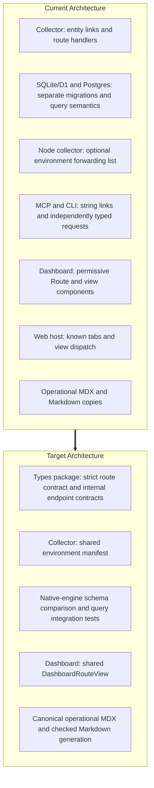

# RFC 0014: Architectural Maintainability & Cross-Surface Contract Unification

- **Status:** Implemented — merged in PR #61 (2026-10-16); verification gaps closed in follow-up PRs (see `docs/rfc-status.md`)
- **Date:** 2026-10-16
- **Code baseline:** `a12eee7` in the monorepo
- **Scope:** `@obsunified/types`, `@obsunified/collector`, `apps/collector-node`, `@obsunified/mcp-server`, `@obsunified/cli`, `@obsunified/dashboard`, `apps/web`, `apps/docs`, `docs/`

---

## 1. Motivation & Evidence Baseline

Prior launch and journey review notes for PRs #31–#57 reported **33 cross-surface issues (`J1`–`J18`, `D1`–`D15`)**. The issue labels and PR associations below are retained as historical context; this revision checks the proposed architecture against the current code, rather than independently re-auditing those reports.

Several contracts are maintained separately across packages: dashboard URLs, database schemas and queries, `/internal/*` requests and responses, collector environment settings, and operational documentation. Sharing definitions and testing the boundaries between their consumers should reduce this maintenance burden. This RFC does not assign a percentage of historical bugs to that pattern: a quantitative claim requires a linked issue-by-issue classification, with overlapping categories counted only once.

Some safeguards already exist. The dashboard has shared parse/serialize helpers, migration filenames and selected timestamp declarations are checked by `src/migrations/parity.test.ts`, and `sql-db-postgres.integration.test.ts` exercises a real Postgres adapter when `OBS_PG_TEST_URL` is configured. The work below extends those checks and closes specific gaps.



| Boundary | Reported issue associations | Current implementation and gap |
| :--- | :--- | :--- |
| Dashboard URL routing | `J14`, `J15`, `J16` (PRs #48, #50, #52, #56) | [dashboard routes](../packages/dashboard/src/routes.ts) use `tab: string`; [known tabs](../apps/web/src/app/router.ts) and raw links in the [collector manifest](../packages/obs-collector/src/plugins/connected-routes/manifest.ts) and [MCP entry point](../packages/mcp-server/src/index.ts) remain separate. |
| Dashboard library and web host | `J15` (PRs #50, #56) | [App.tsx](../apps/web/src/App.tsx) manually dispatches routes and forwards IDs to dashboard views. |
| SQLite/D1 and Postgres | `J3`; migrations 051–053 added in PRs #41, #50, #53 | [SQLite migrations](../packages/obs-collector/src/migrations) and [Postgres migrations](../packages/obs-collector/src/migrations-postgres) each contain **53 numbered SQL files (`001`–`053`)** at the baseline. Filename parity is already tested; complete schema equivalence and query coverage are separate concerns. |
| Internal HTTP contracts | `J9`, `J17`, `J18` (PRs #50, #53) | Collector handlers, MCP tools, CLI commands, and dashboard fetches maintain request and response assumptions separately. |
| Node environment forwarding | `J4` | [framework/env.ts](../packages/obs-collector/src/framework/env.ts) defines `CollectorEnv`; [collector-env.ts](../apps/collector-node/src/collector-env.ts) separately lists a subset of optional settings to forward. Other settings already have explicit host handling. |
| Operational documentation | `D1`–`D15` (PRs #49, #54, #55) | [production.mdx](../apps/docs/content/docs/ops/production.mdx) and [production.md](../docs/ops/production.md), plus the two identity/access guides, duplicate operational content with different paths and headings. |

These associations are not an exhaustive or mutually exclusive root-cause accounting.

---

## 2. Design Principles

1. **Make supported contracts explicit and enforce their use.** Typed builders must reject unknown tabs and fields belonging to another route. Handler response checks and client signatures must share endpoint definitions. Runtime parsing and integration tests cover inputs and independently deployed components that compilation cannot validate.
2. **Keep one authoritative definition where practical.** Derive route keys, environment forwarding, and generated documentation from their respective sources. Database migrations remain dialect-specific; native execution and normalized comparison verify their shared schema contract.
3. **Preserve public package compatibility.** Keep existing exports and accepted call signatures in `@obsunified/types`, `@obsunified/collector`, `@obsunified/dashboard`, `@obsunified/telemetry-sdk`, `@obsunified/cli`, and `@obsunified/mcp-server`. Add strict entry points alongside legacy interfaces and migrate repository callers to them. Removing deprecated interfaces requires a separate breaking-change proposal.
4. **State the limits of each check.** Filename parity does not prove schema parity; schema parity does not prove query behavior; TypeScript declarations do not validate network JSON. Acceptance gates must identify skipped coverage rather than report it as passed.

---

## 3. Concrete Workstreams

### Workstream 1: Strict Dashboard Route Contract in `@obsunified/types`

**Problem:** The shared [Route type](../packages/dashboard/src/routes.ts) currently accepts any tab and independently optional IDs. Both `{ tab: "evals" }` and `{ tab: "service-map", remediationId: "rem_1" }` compile. Moving that type unchanged would not create the promised validation. Collector link producers also emit shapes the current parser cannot fully preserve.

**Design:**

1. Add a pure `packages/obs-types/src/routes.ts` module with a closed, discriminated `DashboardRoute` contract. Derive the supported tab union and `KNOWN_TABS` from one route definition registry. Give each variant its applicable fields; prohibit fields from other variants, including when passed through variables rather than fresh literals. Encode dependencies such as `spanId` requiring `traceId`, and evidence kind/ID forming a selection together. Keep route data independent of React and Worker bindings.
2. Add `parseDashboardRouteHash`, `dashboardRouteToHash`, and typed entity-to-route builders. The parser returns either a valid `DashboardRoute` or an explicit unknown/malformed result; it must not cast arbitrary URL text to the union. Empty hashes resolve to Health; unknown or malformed hashes retain the current host's Health fallback without throwing on invalid percent encoding. Serialization returns `/...`; a separate href helper adds exactly one `#`.
3. Preserve existing `Route`, `parseRouteHash`, `routeToHash`, and `hashRoutes` entry points and their accepted inputs wherever exposed. Compatibility adapters can delegate shared parsing/encoding logic while retaining legacy result shapes and conventions. New repository code uses the strict APIs. Export the new module through the types package's build and package export map and through dashboard/web adapters; verify the packaged exports rather than relying only on source-path imports.
4. Preserve **`CollectorClient.dashboardLink(fragment: string)`** in [packages/mcp-server/src/index.ts](../packages/mcp-server/src/index.ts), including its current URL construction and `undefined` result when no dashboard URL is configured. Mark it deprecated and add **`dashboardRouteLink(route: DashboardRoute)`**. Migrate every repository-owned MCP call site to the strict method; prevent new production uses of the legacy method while allowing compatibility tests.

   ```ts
   client.dashboardRouteLink({ tab: "evaluations", evaluationId });
   client.dashboardRouteLink({ tab: "service-map", service });
   // Negative type tests: unknown tabs and cross-route fields must fail.
   // @ts-expect-error unsupported tab
   client.dashboardRouteLink({ tab: "evals" });
   // @ts-expect-error remediationId is not a service-map field
   client.dashboardRouteLink({ tab: "service-map", remediationId: "rem_1" });
   // Legacy consumers continue to compile and produce the same URL.
   client.dashboardLink("evaluations/ec_1");
   ```

5. Inventory and migrate **all link producers**, not only `hrefForEntity`: `linkToTrace`, `linksFromSpans`, `linksFromMetricExemplars`, log/usage/profile/AI/evaluation/action helpers, fault-locus links, MCP tools, CLI output where applicable, and dashboard navigation. Scan remaining raw dashboard fragments and require explicit explanations for compatibility fixtures or host-specific exceptions. Keep unknown entity kinds routable to the evidence explorer.
6. Define the following compatibility cases before migrating producers. Every selection field must reach a supporting view; where no detail view exists, use an explicit evidence fallback retaining the entity kind and ID instead of silently dropping them.

   | Input or producer | Required behavior |
   | :--- | :--- |
   | `#/traces/<traceId>#span=<spanId>` from span/exemplar helpers | Accept the legacy shape; normalize to the trace route while retaining both selections. New producers emit `#/traces?trace=<traceId>&span=<spanId>`. |
   | `#/traces?trace=<traceId>&span=<spanId>` | Parse, serialize, and forward both IDs. Today neither side handles the span: the shared `Route` has no span field, the parser never reads `span`, and the legacy `#span=` fragment is split by hand in `ConnectedRail` (`components/ConnectedRail.tsx` ~341). The collector manifest already emits both forms (`manifest.ts` ~147/254 legacy, ~565 query form), so the inventory must treat span selection as unsupported end to end, not as a serializer bug. |
   | `#/alerts?id=<id>`, `#/logs?id=<id>`, `#/usage?id=<id>` | Preserve the entity selection in dedicated fields and a consuming view, or explicitly route to evidence when a detail selection is unsupported. |
   | `#/profiles/<id>?trace_id=<traceId>` | Retain the profile selection and trace filter. |
   | `#/evaluations?case=<id>` and `?eval_case_id=<id>` | Accept the existing aliases and emit the canonical evaluation path. |
   | AI, service-map, evidence, incident, finding, change, remediation, session, user, and action-graph links | Retain all supported IDs and filters, including escaped `/`, `#`, spaces, and Unicode. |

**Acceptance:** Negative type tests run under `pnpm type-check`; route round trips preserve supported selections; fixtures cover every inventoried producer and legacy alias. Public legacy calls retain their signatures and behavior. A repository check rejects new uses of the legacy MCP method and unaccounted raw dashboard links. Adding a supported tab requires an exhaustive view-dispatch decision in Workstream 2.

### Workstream 2: Shared Dashboard View Dispatch

**Problem:** [App.tsx](../apps/web/src/App.tsx) manually unpacks route fields and passes them to dashboard components. Package-level component tests do not exercise that host dispatch. The host also owns the Playground view and [lazy-loading declarations](../apps/web/src/app/dashboard-modules.tsx), which must be accounted for during extraction.

**Design:** Export `<DashboardRouteView route={route} onNavigate={navigate} />` from `@obsunified/dashboard`, with exhaustive dispatch over the strict route contract. Keep authentication, chrome, browser history, and host-only view implementation in `apps/web`; supply the Playground through an explicit host-renderer slot. Preserve lazy-loading boundaries and loading fallbacks inside `@obsunified/dashboard` so [dashboard-modules.tsx](../apps/web/src/app/dashboard-modules.tsx) no longer reaches across package boundaries via deep relative `../../../../packages/dashboard/src/dashboards/...` imports. Adapt both existing navigation callback forms (route objects and href strings) at this boundary. Tab changes must not retain IDs belonging to another variant through the current `Partial<Route>` merge behavior.

The dispatcher must forward every selection established in Workstream 1. Extend component props and selection handling where necessary, or implement the specified evidence fallback. Merely receiving an ID in a mocked child is insufficient if the real view ignores it.

**Test harness (prerequisite, not optional):** at the baseline no DOM test environment exists anywhere in the repository. `packages/dashboard` tests render static markup with `react-dom/server`, there is no `jsdom`, `happy-dom`, or `@testing-library/*` dependency, and `apps/web` has no vitest at all; its only test tooling is Playwright (`test:e2e`, `test:e2e:all`). The acceptance below cannot be met without adding one:

1. `packages/dashboard`: add `jsdom` and `@testing-library/react` (plus `@testing-library/user-event` where interaction is asserted) as devDependencies. Keep the default vitest environment `node` so the existing static-markup tests stay fast; opt individual files in with the `// @vitest-environment jsdom` pragma. Real-view selection tests (`DashboardRouteView` rendered with a route, asserting the selected row/panel in the actual view component, no mocked children) live here.
2. `apps/web`: use the existing Playwright setup for the host smoke test (navigation between tabs, Playground host slot, lazy-loading fallbacks, legacy alias redirects) against `vite preview`. Do not add a second unit-test runner to the host; pure routing helpers already live in `packages/dashboard/src/routes.ts` and are tested there.
3. Record which views have real-view selection tests and which rely on the dispatcher table only; a view without a detail selection does not need one.

**Acceptance:** Table-driven tests cover **producer → parser → dispatcher → selected view** for every supported route, including trace/span, alert/log/usage IDs, remediation, evaluation, AI call, service filter, evidence anchors, legacy aliases, and unknown-route fallback. Real-view selection tests run under jsdom in `packages/dashboard` for every view that supports a selection; the Playwright host smoke covers navigation, Playground, and loading boundaries and runs in the recorded verification suite. Existing individual dashboard component exports remain usable.

### Workstream 3: Shared Collector Environment Manifest

**Problem:** [framework/env.ts](../packages/obs-collector/src/framework/env.ts) defines `CollectorEnv`; [collector-env.ts](../apps/collector-node/src/collector-env.ts) separately enumerates optional settings such as retention, narrative configuration, and `ALERT_WEBHOOK_ALLOW_PRIVATE`. Settings outside that subset also have explicit handling in the Node host. A new runtime option can be omitted unless its host mapping is defined.

**Design:** Define the string-setting manifest beside `CollectorEnv`, separating directly forwarded options from settings with explicit host handling. Derive `COLLECTOR_OPTIONAL_STRING_ENV_KEYS` and the corresponding optional fields from that manifest. Keep Worker object bindings (`DB`, buckets, Durable Objects) distinct and preserve the exported `CollectorEnv` interface's structural compatibility. Re-export the runtime constant from the collector package entry point so Node imports a supported package export.

The Node adapter consumes the derived list. Preserve whitespace normalization, blank-to-undefined behavior, warning behavior, and explicit authentication/CORS host configuration. A completeness assertion must account for every optional string field as either directly forwarded or explicitly host-managed; new fields cannot silently escape both categories.

**Acceptance:** Existing environment tests continue to pass. A sentinel-value forwarding test covers every derived key, including `ALERT_WEBHOOK_ALLOW_PRIVATE`; explicit host settings keep their precedence and behavior. The completeness assertion fails when a new optional string field lacks a manifest entry or explicit host mapping.

### Workstream 4: Native-Engine Migration and Query Parity

**Problem:** The **53 migration pairs** contain intentional dialect differences. Postgres migration `001` already includes syntax rejected by SQLite; later migrations include `DO` blocks, catalog lookups, and in-place constraint changes. Interpreting both sets in SQLite or comparing a simplified SQL AST cannot establish their executed schema. Shared queries also have dialect-specific failures beyond `SELECT DISTINCT ... ORDER BY`, including grouping and correlated-subquery errors.

**Design:**

1. **Reuse the fast checks.** Extend [migrations/parity.test.ts](../packages/obs-collector/src/migrations/parity.test.ts), which already checks matching filenames, unique prefixes, and selected Postgres timestamp declarations. Expose that suite as a fast `check:migrations` command and include it in `pnpm check:surfaces`; do not create a duplicate filename checker.
2. **Execute each dialect on its own engine.** Add a `check:db-parity` command that applies all SQLite migrations to a temporary SQLite database and all Postgres migrations to a disposable Postgres database. Reuse the scratch-database lifecycle and empty-database guard in [sql-db-postgres.integration.test.ts](../packages/obs-collector/src/lib/sql-db-postgres.integration.test.ts). When `OBS_PG_TEST_URL` is set the command uses it; when it is unset the command starts a disposable `postgres:15` container itself (random host port, removed on exit) and fails clearly if Docker is unavailable. The current optional integration suite's skip behavior must not count as parity validation. Never target an existing application database.

   **Enforcement (who runs it):** a manual local gate is not an enforcement point; today the one Postgres suite is skipped in every ordinary `pnpm test` run. The command is therefore invoked automatically in two places: (a) `scripts/release/run.sh` (`pnpm release:all`), executed outside the `if ! $SKIP_GATES` guard so it is mandatory and cannot be bypassed by `--skip-gates`, ensuring no image or package ships without both engines having been exercised; and (b) `pnpm test` in `packages/obs-collector` whenever `OBS_PG_TEST_URL` is set or Docker is reachable, so contributors with Docker get it for free. `pnpm check:surfaces` keeps only the fast filename/declaration checks.
3. **Compare executed schema semantics.** Introspect tables, columns, nullability, defaults, primary keys, unique/foreign-key/check constraints, and index columns/expressions, ordering, uniqueness, and predicates. Normalize documented logical equivalents such as integer/boolean storage, integer widths, floating-point types, JSON storage, and engine-generated names. Keep representation mappings distinct from narrowly scoped, documented schema exceptions. Report unexpected differences; do not erase a changed partial-index predicate or missing uniqueness constraint through broad normalization. Audit the current baseline before enforcing parity and fix unintended drift explicitly.
4. **Exercise upgrade behavior as well as fresh installation.** Extend existing upgrade fixtures for migrations such as `041`, `043`, and `045`–`048`, and cover later schema changes where backfills or constraints matter. Verify preserved rows and project isolation, plus the active-incident uniqueness predicate in `051`. Reapplication is required only where a migration promises it. Final empty-database schema equality alone cannot validate data conversion.
5. **Exercise application queries through the real adapters.** Extend the existing Postgres suite with representative internal routes and AutoSRE flows, including the known `42P10` and `42803` query shapes. Use shared seeded fixtures to compare logical results on SQLite and Postgres for the selected queries. Static lint may supplement this coverage, but it is not the dialect-correctness gate and cannot replace query execution.

**Acceptance:** The fast surface check catches missing migration pairs. The explicit database gate runs both engines and the selected query/upgrade fixtures without skips; a removed constraint, changed partial-index predicate, and invalid Postgres query each produce a failing regression fixture. Record the engine versions used and the tested compatibility matrix. `pnpm release:all` fails if the gate fails or cannot run, even when `--skip-gates` is passed, and a `--dry-run` of the release script lists `db-parity` in its plan. This follows the repository's existing workflow without adding GitHub Actions workflows. Do not claim exhaustive query parity from representative coverage.

### Workstream 5: Internal HTTP Contracts Grounded in Existing Handlers

**Problem:** Consumer casts and request strings can drift from the actual handler behavior. A shared contract only helps if it starts from the wire format already served and is enforced at both ends. The original example invented an incidents `count` and `IncidentRecord`, and omitted the approval request's supported `environment` field.

**Design:** Inventory methods, paths, query coercion, request optionality, success/error bodies, authentication, and project scoping from handlers and tests before migrating clients. Cover incidents, findings, changes, remediations, evidence bundles, `/internal/connected/:kind/:id`, evaluation case/run routes (`/internal/eval-cases`, `/internal/eval-runs`, `/internal/evals/runs/:id`), and `/internal/ai/calls/:callId`. Register actual endpoints; wildcard families are planning scope, not callable contract keys.

The initial contract excerpt below reflects the current incidents and approval handlers in [autosre-routes.ts](../packages/obs-collector/src/plugins/autosre-routes.ts). It is a success-contract excerpt, not the entire HTTP error/authentication model:

```ts
import type {
  GrantDeliveryResult,
  IncidentInvestigation,
  RemediationProposal,
} from "@obsunified/types";

type ApproveRemediationResponse = Omit<RemediationProposal, "grantToken"> & {
  proposal: RemediationProposal;
  grantToken: string | null;
  grantDelivery: GrantDeliveryResult;
  webhookDelivery?: {
    delivered: boolean;
    status?: number;
    error?: string;
    attempts: number;
  };
};

export interface InternalEndpoints {
  "GET /internal/incidents": {
    query: { environment?: string; status?: string; limit?: number };
    response: { incidents: IncidentInvestigation[] };
  };
  "POST /internal/remediations/:id/approve": {
    params: { id: string };
    body?: { environment?: string; webhookUrl?: string; secret?: string };
    response: ApproveRemediationResponse;
  };
}
```

The approval response currently includes both `proposal` and flattened proposal fields, a top-level `grantToken` serialized with a null fallback, and an optional `webhookDelivery`. Preserve those compatibility fields. In the types package implementation, use local type imports; the package import above illustrates consumer usage.

Provide `createInternalClient(fetcher)` without an arbitrary line-count target. It must encode path parameters, serialize queries and optional JSON bodies, and preserve each host's base URL, project headers, authentication/cookies, cancellation, timeout, and error handling. Keep existing public client entry points as adapters where needed. Approval remains protected by the human dashboard session requirement; a typed request does not bypass that check or add approval tools to MCP.

**Runtime mechanism (decided):** a TypeScript interface map cannot satisfy "checked construction" or "runtime validation at network boundaries" on its own (Principle 4). Each `InternalEndpoints` entry is therefore defined as **zod schemas** for `params`, `query`, `body`, and `response`, with the TypeScript types inferred from them (`z.infer`). `zod` is already a dependency of `@obsunified/types` (`^3.25`), and the package already ships `ChangeEventInputSchema`, `InvestigationFindingInputSchema`, and `RemediationProposalInputSchema` ([autosre-inputs.ts](../packages/obs-types/src/types/autosre-inputs.ts), added in PR #38). Note that `autosre-inputs.ts` currently checks assignability in only one direction (`AssertAssignable<z.infer<typeof Schema>, Interface>`) and missed PR #50's additions (`idempotencyKey`, partial `fingerprintInput`, optional `webhookUrl`/`secret` on propose, and default/normalized fields on changes and findings); make `_InputSchemaChecks` bidirectional and align those schemas with the handler semantics as part of adopting them.

How the schemas are enforced at each end:

- **Collector handlers** parse `query`/`params`/`body` with the endpoint's input schemas (replacing the hand-written `typeof` chains), using `safeParse` so the existing 400 messages and coercions (`parseLimit`, `|| undefined` on empty strings, optional bodies) are preserved and asserted by fixtures. Responses are built through a typed `respond(endpoint, value)` helper whose argument type is the inferred response type; in test and development builds it additionally runs `response.safeParse` and fails loudly, so a handler that drifts from the schema fails the suite rather than a consumer.
- **Clients** (`createInternalClient`) `safeParse` every response against the endpoint's response schema. A parse failure is a typed `ContractMismatchError` carrying the status, the zod issues, and the raw body, distinct from transport and non-2xx errors. Response schemas use `.passthrough()` on objects and mark fields added after a given version optional, so a newer client against a supported older collector degrades to the documented fallback instead of failing; those pairs are pinned by compatibility fixtures.
- **Non-success statuses** are modelled per endpoint (`403` for the human-session gate on approval, `404`, `409`, `410` for the grant lifecycle) with a shared `{ error, message? }` body schema; anything else is a transport error.

Tie input parsing/validation to the same contract, preserving current coercion and optional-body semantics during this refactor. Keep runtime validation at network boundaries and add handler/client integration tests; a generic JSON cast does not establish runtime compatibility. Independently deployed package versions require explicit compatibility fixtures for supported older responses, including any existing optional-field fallback behavior.

**Acceptance:** Contract fixtures prove incidents contain `incidents` without requiring `count`; approval accepts absent bodies and `environment`, preserves nested/flattened fields, and rejects invalid authentication as before. Compile-time tests reject unsupported paths, missing required parameters, and incorrect field types. Runtime tests prove that a handler returning a field with the wrong type fails the collector suite via the response-schema assertion, and that a client receiving such a body raises `ContractMismatchError` rather than returning a mistyped value. The AutoSRE input schemas in `autosre-inputs.ts` are bidirectionally checked and adopted by their routes. Integration tests verify current JSON and supported older-response fallbacks. No response fields or accepted request semantics change solely to fit the new type map.

### Workstream 6: Canonical Operational MDX with Generated Markdown

**Problem:** Operational MDX and repository Markdown repeat content but differ in link targets and headings. Stripping frontmatter alone would leave links such as `./identity-access` broken in `docs/ops/production.md`. Existing [validate-access-recipes.mjs](../scripts/validate-access-recipes.mjs) checks both content copies and their cross-links, so pointers or generated files require coordinated validator changes.

**Decision:** Use **generated Markdown**, retaining useful repository-readable guides at their existing paths. This workstream covers the two duplicated operational guides; it does not move RFCs, migration notes, or all repository documentation into the website tree.

| Canonical source | Generated destination |
| :--- | :--- |
| `apps/docs/content/docs/ops/production.mdx` | `docs/ops/production.md` |
| `apps/docs/content/docs/ops/identity-access.mdx` | `docs/ops/identity-access-recipes.md` |

**Design:**

1. Reconcile content before switching ownership so information present only in a Markdown copy is preserved in the canonical guide. Record existing incoming section links and preserve their anchors or update the repository references explicitly.
2. Add a deterministic generator with an explicit source/destination map and a check-only mode. Convert frontmatter titles to Markdown headings, add a generated-file notice, and rewrite relative page, asset, and section links for the destination. In particular, `./identity-access` becomes `./identity-access-recipes.md` in the production guide. Resolve other links to mapped Markdown files, actual repository files, or verified published documentation URLs. Preserve code fences and Mermaid blocks verbatim. Handle supported MDX constructs explicitly and fail on unsupported constructs rather than silently stripping them.
3. Wire generation into `pnpm messaging:sync` after any existing canonical-source updates. Wire the non-mutating generation check into `pnpm check:surfaces`. Edit operational prose in MDX; continue editing messaging facts in `packages/messaging/manifest.json` and running the established messaging generation/sync workflow.
4. Update `validate-access-recipes.mjs` to validate substantive guidance against canonical MDX, validate generated Markdown consistency, and retain checks for configuration examples, required notices, routing guidance, and valid cross-links. Add a `check:access-recipes` entry to the surface gate. Validate links in both outputs; a website build alone does not verify repository Markdown links.
5. Correct the validation description: at the baseline, `pnpm check:surfaces` runs messaging checks, skill validation, and the docs build, but **does not run `check:snippets`**. The separate `apps/docs/scripts/check-snippets.mjs` checks only tagged TypeScript/TSX blocks in `sdk-reference.mdx` and `sdks.mdx`; it does not validate all documentation or operational shell/proxy examples. Add that explicit snippet command to the surface gate with its SDK build prerequisites, and continue using the access-recipe checks for operational examples.

**Acceptance:** Generation is deterministic and a second run makes no changes. Check mode fails on manual edits or stale output. Both guides retain required operational content and working links/anchors; existing access-recipe assertions are migrated without dropping substantive coverage. The updated surface gate invokes generation consistency, access-recipe checks, SDK snippet checks after their build prerequisites, and the docs build.

---

## 4. Holistic Execution & Verification Gates

All six workstreams are implemented holistically as one cohesive architectural upgrade inside an isolated Git worktree, preserving public APIs and wire behavior across all packages.

### End-to-End Verification Matrix

| Gate Command | Enforced Scope |
| :--- | :--- |
| `pnpm type-check` | Closed `DashboardRoute` union, negative `@ts-expect-error` route & endpoint tests, bidirectional `_InputSchemaChecks`, `CollectorEnv` manifest completeness assertion, and `<DashboardRouteView />` exhaustive switch. |
| `pnpm test` | Producer → parser → `<DashboardRouteView />` real-view selection tests under `jsdom` (`@testing-library/react`), legacy route & MCP compatibility fixtures, sentinel-value `CollectorEnv` forwarding tests, handler `respond()` schema assertions, client `ContractMismatchError` tests, and older-response fallback fixtures. |
| `pnpm check:surfaces` | Fast `check:migrations` (filename & retention timestamp declarations), operational MDX → Markdown generation drift check, `check:access-recipes` (`validate-access-recipes.mjs` across MDX & generated Markdown links/anchors), `check:snippets` (after SDK declaration builds), raw-dashboard-link / deprecated-`dashboardLink` usage check, messaging sync, skill validation, and `obs-unified-docs build`. |
| `pnpm check:db-parity` | Native-engine SQLite + disposable Postgres (`OBS_PG_TEST_URL` or auto-provisioned `postgres:15` container) execution of all 53 migrations, introspected catalog/constraint/index comparison, upgrade data-preservation fixtures (`041`, `043`, `045`–`048`, `051`), and dual-engine query parity tests (`42P10`, `42803`, AutoSRE & internal routes). Wired into `scripts/release/run.sh` (`pnpm release:all`) unconditionally outside `--skip-gates`. |
| Playwright host smoke (`apps/web`) | End-to-end browser verification of `apps/web` tab navigation, `Playground` host slot, lazy-loading boundaries, and legacy hash alias redirects against `vite preview`. |

Package builds and consumer fixtures must exercise actual export maps and declarations. Completion means every acceptance criterion across Workstreams 1–6 is verified and enforced by the gates above.

## 5. Architectural Review Resolution

| Finding | Required resolution in this revision |
| :--- | :--- |
| 1. SQLite cannot validate executed Postgres migrations | WS 4 uses separate native engines, normalized semantic comparison, existing tests, and an explicit Postgres gate. |
| 2. Moving the permissive `Route` does not provide type safety | WS 1 introduces a closed discriminated contract, runtime parse outcomes, and negative type tests. |
| 3. Other link producers and selection parameters are missed | WS 1 inventories every producer; WS 2 tests selection through real view handling and defined fallbacks. |
| 4. Replacing `dashboardLink(string)` breaks a public API | WS 1 preserves it and adds `dashboardRouteLink`, with legacy compatibility and repository adoption checks. |
| 5. API examples differ from current handlers | WS 5 uses `IncidentInvestigation`, removes the invented `count`, includes approval `environment`, and preserves the existing response shape and auth boundary. |
| 6. Frontmatter-only conversion breaks docs links and validators | WS 6 chooses generation with link/anchor conversion and coordinated access-recipe validation. |
| 7. WS 2 acceptance required DOM tests no harness could run | WS 2 adds jsdom + testing-library to `packages/dashboard` and uses the existing Playwright setup for the host smoke. |
| 8. WS 5 required runtime validation without naming a mechanism | WS 5 defines every endpoint as zod schemas with inferred types, handler response assertions, and client `ContractMismatchError`, starting from bidirectionally checked input schemas in `@obsunified/types`. |
| 9. `check:db-parity` had no automatic invocation | WS 4 wires it into `pnpm release:all` (outside `--skip-gates`, not skippable) and into the collector test run when a database is reachable; the command provisions its own disposable Postgres when none is configured. |
| 10. Span selection described as a serializer bug; migration PR mis-cited | WS 1 records that no span field, parser, or serializer support exists today and that both link forms are already emitted; the migration PRs are #41, #50, #53. |

Factual corrections are reflected throughout: migrations 051–053 came from PRs #41, #50 and #53 (not #45); `CollectorEnv` is in `framework/env.ts`; `CollectorClient` is in MCP's `src/index.ts`; each backend has 53 SQL migrations at the stated baseline; existing migration checks are acknowledged; the snippet command's wiring and limited scope are stated accurately; and unsupported causal percentages, diff-size estimates, and artificial rollout phases are removed.
